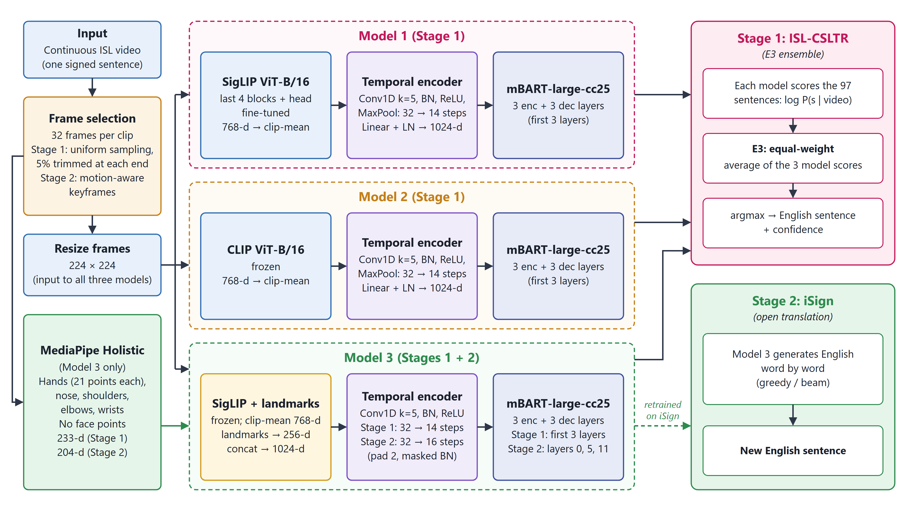
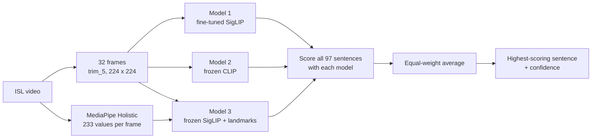
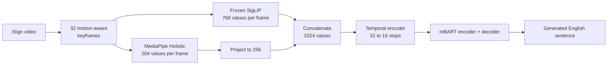

# Two-Stage Indian Sign Language to English Translation System

This project translates Indian Sign Language (ISL) video into English without gloss annotations. It learns only from pairs of videos and English sentences.

| Stage | Task | Dataset | Final system | Test BLEU-4 |
|---|---|---|---|---:|
| **Stage 1** | Closed-set translation: choose the best of 97 known sentences | ISL-CSLTR | E3 ensemble of three models | 67.37 |
| **Stage 2** | Open translation: generate a new English sentence | iSign (subset) | Model 3, retrained on iSign | 0.13 |

**In short:** the system works well on a fixed list of sentences, but it does not yet translate new sentences faithfully. The Stage 2 result is a research baseline, not a working translator.


## Contents

1. [Project overview](#1-project-overview)
2. [Architecture](#2-architecture)
3. [Datasets](#3-datasets)
4. [Requirements](#4-requirements)
5. [Installation](#5-installation)
6. [Repository structure](#6-repository-structure)
7. [Run Stage 1](#7-run-stage-1)
8. [Run Stage 2](#8-run-stage-2)
9. [Predict on your own video](#9-predict-on-your-own-video)
10. [Metrics and results](#10-metrics-and-results)
11. [Troubleshooting](#11-troubleshooting)
12. [Limitations and future work](#12-limitations-and-future-work)
13. [References](#13-references)
14. [Contributing and license](#14-contributing-and-license)

## 1. Project overview

### Why the project has two stages

1. **Baseline.** The project began with ResNet18 and mBART. On the unseen test signer, this baseline predicted only 9 of 91 sentences correctly.
2. **Better visual features.** ResNet18 was replaced with pretrained Vision Transformers: SigLIP and CLIP.
3. **Hand and body information.** MediaPipe Holistic landmarks were added to give the model explicit hand and body positions.
4. **Ensemble.** Three models with different strengths were combined into E3, which predicted 59 of 91 sentences correctly.
5. **Open translation.** Stage 2 removed the fixed sentence list to test real translation on iSign, a much larger and harder dataset.

### How the stages differ

| | Stage 1 | Stage 2 |
|---|---|---|
| **Goal** | Identify the correct known sentence | Generate a new sentence |
| **Dataset** | ISL-CSLTR, 659 clips, 7 signers | iSign subset, 6,904 clips |
| **Split** | By signer: 1–5 train, 6 validation, 7 test | By source video: 4,921 train, 990 validation, 993 test |
| **Vocabulary** | 199 tokens | 19,551 tokens |
| **Models** | Models 1, 2 and 3, combined as E3 | Model 3 only, with **no E3 ensemble** |
| **Frame selection at test time** | Uniform, after trimming 5% from each end (`trim_5`) | 32 motion-aware keyframes |
| **Output** | Highest-scoring of 97 sentences | Word-by-word generation (greedy selected; beam-4 also tested) |

> [!NOTE]
> **Two meanings of "stage".** The `STAGE_2/` folder holds this README's Stage 2. The config files `*_stage1.yaml` and `*_stage2.yaml` and the scripts `train_stage1.py` and `train_stage2.py` are **training steps within this README's Stage 1**. Step 1 trains on frozen features; step 2 fine-tunes the vision encoder. Neither has anything to do with iSign.

## 2. Architecture



### Stage 1: E3 ensemble



### Stage 2: open translation



### The three models

| | Model 1 | Model 2 | Model 3 |
|---|---|---|---|
| **Visual encoder** | SigLIP ViT-B/16 | CLIP ViT-B/16 | SigLIP ViT-B/16 |
| **Encoder training** | Last 4 transformer blocks, plus the output norm and head, fine-tuned | Frozen | Frozen |
| **Frame feature** | 768 values | 768 values | 768 + 256 = 1024 values |
| **Landmarks** | None | None | 233 values (Stage 1) or 204 values (Stage 2), projected to 256 |
| **Clip-mean subtraction** | Yes | Yes | Yes, on the SigLIP part only |
| **Used in** | Stage 1 | Stage 1 | Stage 1 and Stage 2 |
| **Best epoch** | 75, then 14 in fine-tuning | 95 | 65 (Stage 1), 5 (Stage 2) |

**Clip-mean subtraction** removes the clip's average feature from every frame. This reduces what stays constant across a clip, such as the background.

**Landmarks** cover both hands (21 points each), plus the nose, shoulders, elbows and wrists. Face points are not used. If a hand is missed in some frames, its position is interpolated between detections, and detection flags tell the model which values were real. See [`landmark_features.py`](experiments/prediction_improvement_v1/pi_exp/landmark_features.py).

### Temporal encoder

The temporal encoder models how features change over time. It is defined in [`temporal_model.py`](slt_vit/temporal_model.py).

| Layer | Stage 1 shape (time steps × channels) | Notes |
|---|---|---|
| Input | 32 × 768 (Models 1, 2) or 32 × 1024 (Model 3) | |
| Conv1D: 1024 filters, kernel 5, no padding | 28 × 1024 | 32 − 5 + 1 = 28 |
| BatchNorm + ReLU | 28 × 1024 | |
| MaxPool, size 2 | 14 × 1024 | |
| Linear + LayerNorm + ReLU + Dropout | 14 × 1024 | Matches mBART's input size |

Stage 2 uses padding of 2 and masked BatchNorm, so 32 time steps become 16.

### mBART

Both stages use parts of the pretrained `facebook/mbart-large-cc25` model.

| | Stage 1 | Stage 2 |
|---|---|---|
| **Layers** | 3 encoder + 3 decoder, from the first 3 pretrained layers | 3 encoder + 3 decoder, from pretrained layers 0, 5 and 11 |
| **Vocabulary** | 199 tokens | 19,551 tokens |

- **Encoder:** processes the temporal encoder's output as `inputs_embeds`. The video features replace ordinary word input.
- **Decoder:** starts from the `en_XX` language token and uses cross-attention to read the encoded video.
- **Training:** teacher forcing with cross-entropy loss and label smoothing of 0.1.
- **Stage 1 prediction:** each sentence is scored as the sum of `log P(token | previous tokens, video)`, including `</s>`. The decoder calculates these probabilities; it doesn't generate the output.
- **Stage 2 prediction:** the decoder generates up to 64 new tokens, using greedy or beam search.

The model has no gloss supervision and no explicit alignment between signs and words.

### E3 scoring

E3 is configured in [`E_hybrid.json`](experiments/prediction_improvement_v1/configs/E_hybrid.json) as `E3_ens3_candidates_trim5`:

```text
score(s)   = (score_model1(s) + score_model2(s) + score_model3(s)) / 3
prediction = the sentence s with the highest score
confidence = softmax of score(s) over the 97 sentences, for that sentence
```

## 3. Datasets

Neither dataset is included here. Download each from its source and follow its terms of use.

### ISL-CSLTR (Stage 1)

**Download:** [ISL-CSLTR on Kaggle](https://www.kaggle.com/datasets/drblack00/isl-csltr-indian-sign-language-dataset)

| Property | Value |
|---|---|
| Sentences | 97 |
| Signers | 7 |
| Recordings | 663, of which 659 are used |
| Frames | 18,863 |
| Original frame size | 240 × 320 for signers 1–2; 1920 × 1080 for signers 3–7 (width × height) |

**Expected layout**, as used in development. The folder is spelled `ISL_CSLRT_Corpus`:

```text
ISL_CSLRT_Corpus/
├── corpus_csv_files/
│   └── ISL_CSLRT_Corpus_frame_details.xlsx    required: labels for every frame
├── Frames_Sentence_Level/
│   └── <sentence>/
│       └── <take number>/                     the take number is the signer
│           └── *.jpg
└── Videos_Sentence_Level/                     optional: not used for training
```

The dataset already contains extracted frames, so no separate frame extraction is needed.

**Split:** signers 1–5 for training (474 clips), signer 6 for validation (94) and signer 7 for testing (91). This is defined in [`dataset.py`](slt_vit/dataset.py).

**Corrections made by the code:**
- Four recordings are excluded because of label or integrity problems.
- `do you need something/4` is treated as signer 3 after a manual check.

The full list is written to `data/manifest.json` when you run step 1 in [Run Stage 1](#7-run-stage-1).

### iSign (Stage 2)

**Source:** [iSign project page](https://exploration-lab.github.io/iSign) and [paper](https://aclanthology.org/2024.findings-acl.643.pdf). You must obtain it separately.

iSign contains ISL videos with English sentences, drawn from public sources including news and story content. It has no gloss annotations.

| Count | Clips |
|---|---:|
| Pairs reported in the paper | 118,228 |
| Clips in the v1.1 release used in this project | 127,237 |
| Used in this project | 6,904 (about 5.4% of the release) |

| Subset | Clips used | Purpose |
|---|---:|---|
| `train5k` | 4,921 | Training |
| `dev1k` | 990 | Validation |
| `test1k` | 993 | Testing |

The split is grouped by source video, so no source video appears in more than one subset. About 95% of test sentences never appear in the full training split. The same interpreters can appear in training and test, so these results are not signer-independent.

Expected layout:

```text
dataset/iSign/
├── iSign_v1.1.csv                  captions, from the iSign project page
├── videos/iSign-videos_v1.1/       one <uid>.mp4 per clip
└── splits/v1/                      made by step 1 of Run Stage 2
```

The clip lists are in [`STAGE_2/iSign_Model3_1h/manifests/`](STAGE_2/iSign_Model3_1h/manifests/). They hold clip IDs only.

> **iSign captions must not be published.** This repository contains no per-clip references or predictions, and evaluation files that contain captions are ignored by Git.

## 4. Requirements

### Hardware

| | Stage 1 | Stage 2 |
|---|---|---|
| **GPU tested** | NVIDIA RTX 3050 Laptop, 6 GB | NVIDIA RTX 4050 Laptop, 6 GB |
| **Measured peak GPU memory** | About 1.8 GB (Model 3 training) | 2.98 GB (training) |
| **CUDA runtime** | 12.4 | 12.4 |

Plan for at least these Stage 1 disk needs:

| Item | Size |
|---|---:|
| Frame cache | 2.7 GB |
| Feature cache | 0.24 GB per encoder |
| Each main checkpoint | Up to about 720 MB |
| Optional signers 3–5 check | About 20 GB |

The code falls back to the CPU when no GPU is available, but CPU-only training hasn't been tested.

### Software

Development used Windows 11 and Python 3.11. Each stage has its own environment, and Stage 1 uses two because MediaPipe's dependencies conflict with the main stack.

| Package | Stage 1 main (`env`) | Stage 1 MediaPipe (`env_mediapipe`) | Stage 2 main |
|---|---|---|---|
| Python | 3.11 | 3.11 | 3.10 |
| PyTorch | 2.6.0, CUDA 12.4 | Not used | 2.5.1, CUDA 12.4 |
| Transformers | 4.51.3 | Not used | 4.46.3 |
| MediaPipe | Not used | 0.10.14 | Separate environment, 0.10.14 |
| OpenCV | Headless 4.10.0.84 | Contrib 4.11.0.86 | Contrib 4.10.0 (landmark environment) |
| NumPy | 1.26.4 | 1.26.4 | 1.26.4 |

## 5. Installation

These steps set up **Stage 1**. You need [Git](https://git-scm.com/), [Miniconda or Anaconda](https://docs.conda.io/) and an up-to-date NVIDIA driver.

> [!WARNING]
> **Use the conda `--prefix` commands exactly as shown.** The demo looks for `env_mediapipe\python.exe` in the project folder, so a `venv` or a differently named environment will break video uploads.
>
> **Linux hasn't been tested.** The code hardcodes that Windows path in [`demo.py`](experiments/prediction_improvement_v1/pi_exp/demo.py), so uploads in the demo need a code change on Linux. The Linux commands below cover setup only.

### 1. Get the code

```powershell
git clone https://github.com/Srinithija/Gloss_free_SLT.git
cd Gloss_free_SLT
```

### 2. Create the main environment

The same versions are also listed in `requirements.txt` and `requirements-mediapipe.txt`.

**Windows PowerShell:**

```powershell
conda create --prefix .\env python=3.11 -y
env\python.exe -m pip install torch==2.6.0 torchvision==0.21.0 --index-url https://download.pytorch.org/whl/cu124
env\python.exe -m pip install transformers==4.51.3 sentencepiece==0.2.0 safetensors==0.4.5 numpy==1.26.4 opencv-python-headless==4.10.0.84 sacrebleu==2.4.3 pandas==2.2.3 openpyxl==3.1.5 pyyaml==6.0.2 streamlit==1.40.2 protobuf==5.28.3
```

**Linux (not tested):**

```bash
conda create --prefix ./env python=3.11 -y
env/bin/python -m pip install torch==2.6.0 torchvision==0.21.0 --index-url https://download.pytorch.org/whl/cu124
env/bin/python -m pip install transformers==4.51.3 sentencepiece==0.2.0 safetensors==0.4.5 numpy==1.26.4 opencv-python-headless==4.10.0.84 sacrebleu==2.4.3 pandas==2.2.3 openpyxl==3.1.5 pyyaml==6.0.2 streamlit==1.40.2 protobuf==5.28.3
```

Check that PyTorch can see your GPU:

```powershell
env\python.exe -c "import torch; print(torch.__version__, torch.cuda.is_available())"
```

This should print `2.6.0+cu124 True`.

### 3. Create the MediaPipe environment

**Windows PowerShell:**

```powershell
conda create --prefix .\env_mediapipe python=3.11 -y
env_mediapipe\python.exe -m pip install mediapipe==0.10.14 numpy==1.26.4
```

**Linux (not tested):**

```bash
conda create --prefix ./env_mediapipe python=3.11 -y
env_mediapipe/bin/python -m pip install mediapipe==0.10.14 numpy==1.26.4
```

### 4. Download the mBART files

The code needs `model.safetensors`, which isn't on the model's main branch, so two downloads are required. They go to the default Hugging Face cache, which is where the code looks:

```powershell
env\python.exe -c "from huggingface_hub import snapshot_download as d; d('facebook/mbart-large-cc25', allow_patterns=['config.json','generation_config.json','tokenizer.json','sentencepiece.bpe.model']); d('facebook/mbart-large-cc25', revision='69c1efc0bdfab6824fe4a9d267df1e38a4fbbe15', allow_patterns=['model.safetensors'])"
```

**SigLIP and CLIP** download automatically to `cache/hf/` the first time you need them, at the fixed revisions set in [`vision_encoder.py`](slt_vit/vision_encoder.py). No environment variables are required.

### 5. Set the dataset path

Open [`slt_vit/paths.py`](slt_vit/paths.py) and change line 8 to your dataset folder:

```python
DATASET = r'C:\path\to\ISL_CSLRT_Corpus'
```

The `OLD_MANIFEST` setting on line 9 can stay as it is. It's an optional cross-check, and the code skips it if the file is missing.

## 6. Repository structure

```text
.
├── configs/                          training settings for Models 1 and 2
│   ├── siglip_b16_stage1.yaml        frozen SigLIP: first training step for Model 1
│   ├── siglip_b16_stage2.yaml        fine-tuning: Model 1
│   └── clip_b16_stage1.yaml          Model 2
├── data/manifest.json                verified signer split
├── slt_vit/                          core package
│   ├── paths.py                      all file locations
│   ├── dataset.py                    annotations, checks and split
│   ├── cache.py                      frame and feature caches
│   ├── frames.py                     video reading and preprocessing
│   ├── vision_encoder.py             SigLIP and CLIP
│   ├── temporal_model.py             temporal encoder
│   ├── text_model.py                 compact mBART and trimmed vocabulary
│   ├── train.py, evaluate.py         training and evaluation
│   ├── infer.py                      single-model prediction
│   ├── metrics.py                    BLEU and ROUGE-L
│   ├── loso.py                       leave-one-signer-out check
│   └── app.py                        older single-model Streamlit app
├── experiments/
│   └── prediction_improvement_v1/    Model 3, E3 and the main demo
│       ├── train_features.py         Model 3 training
│       ├── run_inference.py          validation of settings such as E3
│       ├── show_predictions.py       per-clip predictions and confidence
│       ├── run_demo.py, demo_app.py  main Streamlit demo
│       ├── configs/                  E3 definition and other evaluated settings
│       ├── landmarks/                MediaPipe extraction
│       ├── pi_exp/                   scoring, views, landmark features, demo logic
│       ├── tools/repeat_test.py      recorded signer 7 evaluation
│       ├── tests/                    unit tests for this experiment
│       └── reports/                  experiment reports and logs
├── report_figures/                   architecture diagram
├── tests/                            unit tests
├── tools/protect.py                  checks the author's earlier project during training
├── requirements.txt                  main environment
├── requirements-mediapipe.txt        MediaPipe environment
├── train_stage1.py, train_stage2.py  training entry points
├── run_app.py                        launches the older app
└── STAGE_2/                          Stage 2 (iSign): see its README
    ├── iSign_Project_Report.md       full project report
    ├── iSign_Model3_Experiment_Report.md
    ├── isign_siglip_slt/             pipeline: model, data, metrics, scripts, configs, tests
    ├── iSign_Model3_1h/              experiment: configs, clip lists, logs, metrics
    └── baseline_resnet/isign_opt/    ResNet-18 baseline on iSign
```

Generated at run time: `cache/` (features and weights), `outputs/` (Models 1 and 2) and `experiments/prediction_improvement_v1/runs/` (Model 3).

## 7. Run Stage 1

Run every command from the project folder in PowerShell, using `env\python.exe`. Linux would use `env/bin/python`.

> [!NOTE]
> `--set verify_old_project=false` is required on any new computer. Without it, training stops because it checks a private snapshot of the author's earlier project, which you won't have.

### Prepare the data

**1. Build the manifest.** This overwrites `data/manifest.json` with paths for your computer:

```powershell
env\python.exe -m slt_vit.dataset
```

Expect `annotation rows 18863, take folders 663, eligible 659, excluded 4`.

**2. Build the caches.** This also downloads SigLIP and CLIP:

```powershell
env\python.exe -m slt_vit.cache frames
env\python.exe -m slt_vit.cache features --encoder siglip_b16_224
env\python.exe -m slt_vit.cache features --encoder clip_b16_224
```

**3. Extract landmarks for training and validation.** The `-I` flag is required:

```powershell
env_mediapipe\python.exe -I experiments\prediction_improvement_v1\landmarks\extract.py all --mode static
```

**4. Run the tests** (optional):

```powershell
env\python.exe -m unittest discover -s tests
```

### Train the models

Keep these run names, because E3 looks for checkpoints at these exact paths.

**5. Train Model 1.** The first command trains on frozen features, and the second fine-tunes from that result:

```powershell
env\python.exe train_stage1.py --config configs\siglip_b16_stage1.yaml --set verify_old_project=false
env\python.exe train_stage2.py --config configs\siglip_b16_stage2.yaml --set verify_old_project=false
```

**6. Train Model 2:**

```powershell
env\python.exe train_stage1.py --config configs\clip_b16_stage1.yaml --set verify_old_project=false
```

**7. Train Model 3:**

```powershell
env\python.exe experiments\prediction_improvement_v1\train_features.py --name H1_siglip_landmarks --inputs siglip+landmarks
```

To continue an interrupted run of `train_stage1.py` or `train_stage2.py`, add `--resume`. Existing experiments are never overwritten.

| Model | Checkpoint |
|---|---|
| Model 1 | `outputs/siglip_b16_stage2/best.pt` |
| Frozen SigLIP, also used by the demo | `outputs/siglip_b16_stage1/best.pt` |
| Model 2 | `outputs/clip_b16_stage1/best.pt` |
| Model 3 | `experiments/prediction_improvement_v1/runs/H1_siglip_landmarks/best.pt` |

**Training settings:**

| Setting | Models 2, 3 and Model 1's first step | Model 1 fine-tuning |
|---|---|---|
| Batch size | 16 | 2, with 8 accumulation steps |
| Maximum epochs | 100 | 40 |
| Learning rate: new layers / mBART / vision | 3e-4 / 1e-4 / none | 1e-4 / 3e-5 / 1e-5 |
| Warm-up steps | 200 | 50 |
| Validate every | 5 epochs | 2 epochs |
| Early-stopping patience | 8 evaluations | 6 evaluations |
| Best checkpoint | Highest validation BLEU-4 | Highest validation BLEU-4 |

### Validate and test

**8. Validate E3 on signer 6:**

```powershell
env\python.exe experiments\prediction_improvement_v1\run_inference.py --set val --extra experiments\prediction_improvement_v1\configs\E_hybrid.json --settings E3_ens3_candidates_trim5
```

**9. Show per-clip predictions on signer 6:**

```powershell
env\python.exe experiments\prediction_improvement_v1\show_predictions.py --set val --setting E3
```

**10. Test E3 on signer 7.** Do this only after every choice is final. Signer 7 must never be used to choose models, settings or decoding methods. Landmarks for signer 7 are extracted only with `--include-test`. The `evaluate` command records Model 1's initial test, which `repeat_test.py` needs for its comparison. The tool refuses to evaluate the same setting twice:

```powershell
env_mediapipe\python.exe -I experiments\prediction_improvement_v1\landmarks\extract.py all --mode static --include-test
env\python.exe -m slt_vit.evaluate --ckpt outputs\siglip_b16_stage2\best.pt --split test --final
env\python.exe experiments\prediction_improvement_v1\tools\repeat_test.py R2
env\python.exe experiments\prediction_improvement_v1\show_predictions.py --set test --setting E3
```

Results are saved in `experiments/prediction_improvement_v1/results/` and logged in `REPEAT_TEST_LEDGER.csv` in that folder.

**Evaluate one model on its own:**

```powershell
env\python.exe -m slt_vit.evaluate --ckpt outputs\siglip_b16_stage2\best.pt --split val
```

Testing on signer 7 this way also requires `--split test --final`, and it writes to `outputs/TEST_EVALUATION_LEDGER.csv`.

**Optional check on other signers.** This trains one model per held-out signer and needs about 20 GB. `slt_vit.loso` doesn't accept `--set`, so first add the line `verify_old_project: false` to each YAML file you pass to it:

```powershell
env\python.exe -m slt_vit.loso --configs configs\siglip_b16_stage1.yaml configs\clip_b16_stage1.yaml --folds 3 4 5
```

### Baseline

The ResNet18 baseline is in a separate project, not this folder. It uses an older environment: Python 3.9, PyTorch 1.13 and Transformers 4.32.

> **TODO:** add the baseline's location once its code (`isl_slt`) is published.

## 8. Run Stage 2

All Stage 2 code is in [`STAGE_2/`](STAGE_2/README.md). The commands are for PowerShell on Windows. Checkpoints and feature caches aren't in this repository, so results come from running these steps.

**Set up.** You need Python 3.10. From `STAGE_2\isign_siglip_slt`:

```powershell
python -m venv envs\main
envs\main\Scripts\pip install -r requirements_main.txt
python -m venv envs\mediapipe
envs\mediapipe\Scripts\pip install -r requirements_mediapipe.txt
```

Then set your dataset, LMDB and mBART locations in `slt\paths.py`.

**Prepare the data.** Steps 1 and 2 use scripts from the project's baseline repository, [REVETHA/glossfreeslt](https://github.com/REVETHA/glossfreeslt), with its own environment (`assets/requirements.txt`). Clone it as `sltbaselines`, next to `dataset`, and run these from the folder holding both:

```powershell
git clone https://github.com/REVETHA/glossfreeslt.git sltbaselines

# 1. Build the train, dev and test split, grouped by source video (seed 42)
python sltbaselines\scripts\create_isign_splits.py

# 2. Store up to 128 evenly spaced frames per clip in LMDB
python sltbaselines\scripts\prepare_isign_lmdb.py --sampling uniform --max-frames 128 --jpeg-quality 80 --dataset-root dataset\iSign --output-root D:\iSign_LMDB
```

`scripts\audit_data.py` also reads the trimmed mBART tokenizer that `sltbaselines\scripts\prepare_isign_models.py` prepares.

**Select keyframes and extract features.** From `STAGE_2\isign_siglip_slt`:

```powershell
# 3. Audit all clips and flag bad crops
envs\main\Scripts\python.exe scripts\audit_data.py

# 4. Select 32 motion-aware keyframes
envs\main\Scripts\python.exe scripts\select_keyframes.py

# 5. Frozen SigLIP features: train + dev, then test
envs\main\Scripts\python.exe scripts\extract_visual.py --manifest ..\iSign_Model3_1h\manifests\trdev_extract.csv --out cache\full_k32\siglip --encoder siglip --positions manifests\keyframes_K32.json
envs\main\Scripts\python.exe scripts\extract_visual.py --manifest ..\iSign_Model3_1h\manifests\test1k.csv --out ..\iSign_Model3_1h\cache\siglip_test --encoder siglip --positions manifests\keyframes_K32.json

# 6. MediaPipe landmarks: train + dev, then test
envs\mediapipe\Scripts\python.exe scripts\extract_landmarks.py --manifest ..\iSign_Model3_1h\manifests\trdev_extract.csv --out cache\full_k32\landmarks --workers 14 --positions manifests\keyframes_K32.json --complexity 1
envs\mediapipe\Scripts\python.exe scripts\extract_landmarks.py --manifest ..\iSign_Model3_1h\manifests\test1k.csv --out ..\iSign_Model3_1h\cache\landmarks_test --workers 14 --positions manifests\keyframes_K32.json --complexity 1
```

**Train and evaluate.** From `STAGE_2\iSign_Model3_1h`:

```powershell
$py = "..\isign_siglip_slt\envs\main\Scripts\python.exe"

# 7. Check shapes, loss, gradients and parameter updates on one batch
& $py sanity_check.py

# 8. Train Model 3, validating every epoch (the SigLIP-only baseline is configs\visual_only_5k.json)
& $py run_train.py --config configs\m3_hybrid_5k.json

# 9. Evaluate on test1k, greedy and beam-4
& $py eval_test.py runs\m3_hybrid_5k

# 10. Word-recognition test and log tables
& $py keyword_probe.py hybrid
& $py make_logs.py
```

The original run took about 3,000 of its training clips' features from an earlier cache, re-indexed to the same 32 keyframes. On 297 clips in both caches the landmarks were identical and the SigLIP features differed only by rounding. Step 5 and step 6 produce them all in one pass instead.

**Keyframe selection:** motion energy is measured on 64 × 64 greyscale frames to find the active signing span. Frames are then sampled half by motion and half uniformly.

**Training settings:**

| Setting | Value |
|---|---|
| Batch size | 32, grouped by caption length |
| Optimiser | AdamW, weight decay 0.01 |
| Learning rate | 3e-4 for new layers, 1e-4 for mBART |
| Schedule | Linear warm-up, then cosine decay |
| Precision | BF16 |
| Regularisation | Dropout 0.1, feature dropout 0.1, label smoothing 0.1, keep a random 80–100% of frames |
| Model selection | Best validation BLEU-4 with greedy decoding, patience 4, best epoch 5 |
| Speed | 19 s per epoch on 4,921 clips |

**Important differences from Stage 1:**
- There is no E3 ensemble and no sentence list.
- Model 3 is retrained from scratch on iSign.
- Landmark features have 204 values, not 233, with a different layout: Stage 2 keeps 25 pose points as xyz and drops body-relative hand points and pose visibility.
- mBART uses pretrained layers 0, 5 and 11.
- Environments and library versions differ, so a Stage 1 checkpoint can't be used here.

## 9. Predict on your own video

### Demo app (Stage 1, E3)

The demo is the easiest way to test the system. It runs the full E3 ensemble, so it needs all four checkpoints from [step 5–7](#train-the-models), the MediaPipe environment and the mBART files.

```powershell
env\python.exe experiments\prediction_improvement_v1\run_demo.py
```

Then:
1. Open <http://localhost:8503>.
2. On **Upload a video**, choose your file.
3. Click **Translate video**.

**Supported formats:** `.mp4`, `.avi`, `.mov`, `.mkv`, `.webm` and `.m4v`. There's no input folder; you upload the file directly in the browser.

**Video requirements:**
- It should show one signed sentence.
- There's no required resolution. Frames are centre-cropped to at most 4:3, padded to a square and resized to 224 × 224.
- It needs at least 2 readable frames. Only the first 2,000 are read.
- If the browser can't play your video format, the app converts a preview for display. Translation always uses your original file.

**Expected output:**

```text
can i help you
Confidence  50.8%
```

The **confidence** is how strongly E3 prefers this sentence over the other 96. It is not a guarantee. The sentence will always be one of the 97 known sentences, so a video of any other sentence will still return one of them, possibly with high confidence.

### Command line (one model, no E3)

There is no command-line tool that runs E3 on your own video. This command runs one model with greedy decoding:

```powershell
env\python.exe -m slt_vit.infer --ckpt outputs\siglip_b16_stage2\best.pt "C:\path\to\video.mp4"
```

Output: `<file>` `<predicted sentence>` `(<seconds>s model)`, separated by tabs.

### Stage 2

The demo doesn't support Stage 2. To predict from the command line, first train a model ([Run Stage 2](#8-run-stage-2)). Then, from `STAGE_2\isign_siglip_slt`:

```powershell
envs\main\Scripts\python.exe scripts\infer.py --run ..\iSign_Model3_1h\runs\m3_hybrid_5k --video clip.mp4 --decoding '{\"num_beams\":1}'
```

> **Limitation:** this command uses evenly spaced frames, while the models were trained on motion-aware keyframes, so its results may differ from the reported ones.

## 10. Metrics and results

| Metric | What it measures | Scale |
|---|---|---|
| **Exact sentence accuracy** | Share of predictions identical to the reference sentence | 0–100% |
| **BLEU-1** | Overlap of single words with the reference | 0–100 |
| **BLEU-4** | Overlap of word sequences up to 4 words. This is the standard translation metric | 0–100 |
| **ROUGE-L** | Length of the longest shared word sequence, in order, as an F-score | 0–100 |

For all of them, higher is better. BLEU is calculated with sacreBLEU, across the whole test set. ROUGE-L uses β = 1.2 on ISL-CSLTR and β = 1 on iSign.

### Stage 1: ISL-CSLTR, test signer 7 (91 clips)

| Model | Prediction method | Exact | BLEU-1 | BLEU-4 | ROUGE-L | Evaluation |
|---|---|---:|---:|---:|---:|---|
| ResNet18 baseline | Greedy | 9/91 (9.9%) | 22.60 | 12.57 | 23.20 | Official test |
| Model 1: fine-tuned SigLIP | Greedy | 23/91 (25.3%) | 35.78 | 25.90 | 37.57 | **Initial test** |
| Model 1: fine-tuned SigLIP | Sentence scoring | 27/91 (29.7%) | 40.38 | 30.75 | 42.12 | Repeat (R5) |
| Model 2: frozen CLIP | Sentence scoring | 43/91 (47.3%) | 55.06 | 49.82 | 55.15 | Repeat (R4b) |
| Model 3: SigLIP + landmarks | Sentence scoring | 41/91 (45.1%) | 53.90 | 47.64 | 53.92 | Repeat (R3b) |
| **E3 ensemble** | Sentence scoring | **59/91 (64.8%)** | **70.20** | **67.37** | **70.33** | Repeat (R2) |

The initial test of the first selected model (Model 1, greedy) gave 23/91. All later signer 7 results are **repeat evaluations** on the same signer, with settings fixed beforehand using other signers. They could be slightly optimistic compared with a first-time test.

E3 also reached 74/94 (78.7%) on validation signer 6, and 211/282 (74.8%) on signers 3–5, with each scored by a model trained without that signer.

### Stage 2: iSign test1k (993 clips)

| Model | Decoding | BLEU-1 | BLEU-4 | ROUGE-L |
|---|---|---:|---:|---:|
| Model 3: SigLIP + landmarks (selected) | Greedy | 8.76 | 0.13 | 8.58 |
| Model 3: SigLIP + landmarks | Beam-4 | 6.97 | 0.24 | 6.73 |

Exact match was 0%, and 394 of 993 clips shared no words with the reference. The outputs read as fluent English but don't faithfully translate the signs.

These values are recorded in [`test_metrics.json`](STAGE_2/iSign_Model3_1h/runs/m3_hybrid_5k/test_metrics.json). The other runs and the epoch-by-epoch logs are in the same folder and in [`logs/project_logs/`](STAGE_2/iSign_Model3_1h/logs/project_logs/).

### Comparing the stages

These scores **can't be compared directly**. Stage 1 chooses from a known list, while Stage 2 generates new sentences. The datasets and vocabulary (199 vs 19,551 tokens) also differ, and so does the text processing: iSign text is lowercased with punctuation removed.

## 11. Troubleshooting

| Problem | Likely cause | Solution |
|---|---|---|
| `the original sltbaselines project changed; stopping` | Training is checking the author's earlier project | Add `--set verify_old_project=false` |
| `model.safetensors of facebook/mbart-large-cc25 not found` | mBART files missing | Run [step 4 of the installation](#4-download-the-mbart-files), including the revision download |
| `sentencepiece.bpe.model of facebook/mbart-large-cc25 not found` | Tokenizer files missing | Same as above |
| `FileNotFoundError` for the Excel file, frame folders or manifest | Wrong dataset path, or the manifest was built for another computer | Fix `DATASET` in `slt_vit/paths.py`, then run `env\python.exe -m slt_vit.dataset` |
| Missing annotation file | `corpus_csv_files` is incomplete | Check the [expected layout](#isl-csltr-stage-1), and re-download if needed |
| `MediaPipe environment not found` | `env_mediapipe` is missing or was created differently | Create it with the exact `--prefix` command |
| `MediaPipe failed: ...` or `protobuf` errors | MediaPipe is in the wrong environment | Keep MediaPipe in `env_mediapipe` only, and include `-I` when running `extract.py` |
| `CUDA out of memory` in fine-tuning | Not enough GPU memory | Lower `batch_size` and raise `accum_steps` to compensate, or lower `vision_trainable_blocks` in the YAML |
| `torch.cuda.is_available()` is `False` | CPU-only PyTorch or a driver problem | Reinstall PyTorch using the `cu124` command, and update your NVIDIA driver |
| Loading a `.bin` file fails | PyTorch is too old for Transformers 4.51 | Use `torch==2.6.0`, as CLIP's weights are stored as `.bin` |
| `ModuleNotFoundError` | A package is missing or the wrong Python is running | Use `env\python.exe` and rerun the install commands |
| `... already has checkpoints; use --resume or a new experiment name` | The experiment exists | Add `--resume`, or `--set name=my_run` |
| `the test split is held out: pass --final` | Protection for signer 7 | Add `--final` only for a final test |
| `... was already evaluated on signer 7` | The setting is already in the ledger | This is intentional, so review the saved results instead |
| `signer 7 is only evaluated by tools/repeat_test.py` | Protection for signer 7 | Use `repeat_test.py` |
| Checkpoint fails to load, or tensor sizes differ | Code, config or vocabulary don't match the checkpoint | Keep the original config, and don't mix Stage 1 and Stage 2 checkpoints. The code stops on a failed load and never substitutes random weights |
| Video preview is blank in the demo | The browser can't play the video's codec, in an older copy of the app | Use the current `demo_app.py`, which converts the preview |
| Symlink warnings from Hugging Face on Windows | Windows file permissions | Safe to ignore |

## 12. Limitations and future work

| Limitation | Possible future work |
|---|---|
| Stage 1 can only output 97 predefined sentences | Develop open translation that can replace the fixed list |
| Stage 2 open translation is weak (BLEU-4 0.13) and doesn't faithfully translate signs | Train on far more data, and adapt the visual encoder to sign language |
| Stage 2 trained on 4,921 clips, about 5% of the full training split | Finish landmark extraction for the full split |
| ISL-CSLTR is small, and accuracy varies by signer (78.7% on signer 6, 64.8% on signer 7) | Add more signers, sentences and recording conditions |
| Facial expressions aren't modelled | Add face features, which carry grammar and meaning in ISL |
| Hand tracking is weaker on low-resolution video | Use higher-resolution video or a stronger pose estimator |
| Every clip is reduced to 32 frames | Choose the frame count based on clip length |
| E3 takes about 2.7 s per clip, mostly MediaPipe on the CPU | Use faster landmark extraction and lighter models |
| One sentence per clip, with no continuous signing | Add automatic sentence segmentation |
| Signer 7 has been evaluated repeatedly | Confirm the final system once on new signers |

These are proposed directions; they haven't been tested.

## 13. References

1. **ISL-CSLTR dataset:** [Kaggle copy](https://www.kaggle.com/datasets/drblack00/isl-csltr-indian-sign-language-dataset); Elakkiya, R. and Natarajan, B. *ISL-CSLTR: Indian Sign Language Dataset for Continuous Sign Language Translation and Recognition.* Mendeley Data, 2021. [doi:10.17632/kcmpdxky7p.1](https://doi.org/10.17632/kcmpdxky7p.1)
2. **iSign:** Joshi, A. et al. *iSign: A Benchmark for Indian Sign Language Processing.* Findings of ACL, 2024. [Paper](https://aclanthology.org/2024.findings-acl.643/), [project page](https://exploration-lab.github.io/iSign)
3. **SigLIP:** Zhai, X. et al. *Sigmoid Loss for Language Image Pre-Training.* ICCV, 2023. [arXiv:2303.15343](https://arxiv.org/abs/2303.15343)
4. **CLIP:** Radford, A. et al. *Learning Transferable Visual Models From Natural Language Supervision.* ICML, 2021. [arXiv:2103.00020](https://arxiv.org/abs/2103.00020)
5. **MediaPipe:** Lugaresi, C. et al. *MediaPipe: A Framework for Building Perception Pipelines.* 2019. [arXiv:1906.08172](https://arxiv.org/abs/1906.08172)
6. **mBART:** Liu, Y. et al. *Multilingual Denoising Pre-training for Neural Machine Translation.* TACL, 2020. [arXiv:2001.08210](https://arxiv.org/abs/2001.08210)
7. **Baseline framework:** Sincan, O. M., Low, J. H., Asasi, S. and Bowden, R. *Gloss-Free Sign Language Translation: An Unbiased Evaluation of Progress in the Field.* Computer Vision and Image Understanding, 2025. [doi:10.1016/j.cviu.2025.104498](https://doi.org/10.1016/j.cviu.2025.104498)

## 14. Contributing and license

**To contribute:**
1. Open an issue describing the change.
2. Work in a new branch.
3. Run `env\python.exe -m unittest discover -s tests` before submitting.
4. Never use signer 7 to choose models, settings or decoding methods.
5. Don't add datasets, checkpoints or environments to Git.

**License:**

> **TODO:** this code has no license file yet. Without one, others have no explicit permission to reuse it. The upstream baseline project is MIT-licensed, and its notice must be kept wherever its code is reused. Dataset and pretrained model terms apply separately.
