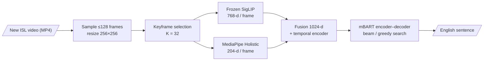

# Gloss-Free Indian Sign Language to English Translation on iSign using Frozen SigLIP and MediaPipe Holistic Features with an mBART Decoder

---

## Table of Contents
1. Introduction
2. Problem Definition
3. Existing System
4. Proposed System
5. Objectives of the Project
6. Literature Review
7. System Requirements (Hardware and Software)
8. Tools and Technologies Used
9. System Design: Architectural Design
10. Module Description
11. Implementation
    - 11.1 Dataset Description
    - 11.2 Model Training and Integration
    - 11.3 System Workflow
    - 11.4 Training and Testing Pipeline
    - 11.5 Sample Code
    - 11.5 Training and Testing Pipeline
12. Results
    - 12.1 Performance Analysis
    - 12.2 Evaluation
    - 12.3 Comparison with Existing Models
13. Conclusion
14. Key Achievements
15. References

---

## 1. Introduction

Sign languages are complete natural languages with their own grammar, expressed through hand shape, hand movement, body posture and facial expression. Indian Sign Language (ISL) is the main sign language of the Deaf community in India.
- **Population:** the Census of India 2011 counted about **5.07 million** people with hearing disability. Advocacy groups such as the National Association of the Deaf estimate the number of Deaf and hard-of-hearing people at about **18 million** [13].
- **Interpreter shortage:** there are very few qualified ISL interpreters, so everyday communication between Deaf signers and non-signers is a real accessibility barrier.
- **Growing resources:** ISL has been standardised and documented more in recent years. The ISLRTC dictionary grew from about 3,000 terms (2018) to about 10,000 terms (2021) [13].

**Sign Language Translation (SLT)** is the task of turning a sign language video directly into a sentence in a spoken language such as English. It is harder than isolated sign recognition:
- The output is an open-vocabulary sentence, not a class label.
- Sign order and grammar differ from English.
- There is no word-by-word alignment between video frames and text.

Most successful SLT systems use **glosses**, which are written labels for each sign, as an intermediate step [3, 4]. Gloss annotation is very expensive, and large ISL corpora such as **iSign** [1] provide **only English sentences**, with no glosses. This project therefore follows the **gloss-free** approach: it learns directly from video–sentence pairs.

The project builds on our earlier experiments on a small ISL sentence dataset. There, a combination of a **frozen SigLIP vision encoder** [5] and **MediaPipe Holistic body and hand landmarks** [8] ("Model 3") was the strongest single model. In this report we move that architecture to the large, open-vocabulary **iSign benchmark** and evaluate it honestly.

---

## 2. Problem Definition

**Given** a video clip of a person signing one ISL sentence, **generate** the corresponding English sentence.

Formally, let a video be V = (f₁, …, f_N) with N frames. Let its translation be the English token sequence Y = (y₁, …, y_M). The system learns a model p(Y | V) and outputs Ŷ = argmax p(Y | V).

**Constraints that make the problem difficult on iSign:**

| Constraint | Effect on the problem |
|---|---|
| No gloss annotations | No intermediate supervision; the model must discover sign–word links by itself |
| Open vocabulary | 98,155 distinct training sentences and 33,329 word types; only **4.6%** of test sentences appear in training. Classification over a fixed sentence list is impossible. |
| Long, variable-length videos | Median 183 frames per clip (about 6.6 s); up to 2,370 frames |
| Real-world video | News broadcast and story-book videos, studio logos, varying resolution (85% are 300×300) |
| Limited hardware | One 6 GB laptop GPU; the full mBART (about 611M parameters) cannot be fine-tuned end to end |

**Problem statement.** Design, implement and evaluate a gloss-free ISL-to-English translation system on iSign that:
1. selects meaningful frames from each video;
2. represents them with frozen visual features and body/hand landmarks;
3. models their temporal order;
4. generates English text with a pretrained multilingual sequence-to-sequence model;
5. reports honestly whether real sign-to-text learning happens.

---

## 3. Existing System

### 3.1 General existing approaches
1. **Isolated sign recognition** (for example, the INCLUDE dataset for ISL words [10]). It classifies single words and cannot produce sentences.
2. **Gloss-based SLT** [3, 4]. Video → gloss sequence (CTC) → text. It works well on PHOENIX-2014T but needs gloss labels, which iSign does not have.
3. **Gloss-free SLT** [6, 7]. Video → text directly, often with visual–language pre-training. Reported BLEU-4 on German and Chinese benchmarks is still far below text-to-text translation; for example, GFSLT-VLP reports 21.44 on PHOENIX-2014T and 11.00 on CSL-Daily [6].
4. **iSign baselines** [1]. The iSign authors report very low scores for ISL-to-English translation:
   - Best SignVideo-to-Text BLEU-4: **0.56**.
   - Best SignPose-to-Text BLEU-4: **1.47**.
   - In their words, "The BLEU scores for Sign-to-Text translation … are a bit low."

### 3.2 Our own earlier system (ISL, Kaggle sentence dataset)
Earlier in this project we worked on a small ISL continuous-sentence dataset; the ISL-CSLRT corpus has about 700 videos of 100 sentences by 7 signers [11]. Because each sentence is repeated many times, that task effectively became **sentence recognition**.

| Model (historical, ISL) | Exact Match | BLEU-4 | ROUGE-L |
|---|---:|---:|---:|
| ResNet18 (original) | 9.9% | 12.6 | 23.2 |
| Model 1: fine-tuned SigLIP | 25.3% | 25.9 | 37.6 |
| Model 3 alone (frozen SigLIP + MediaPipe), greedy | 37.4% | 43.9 | 47.6 |
| Model 3 alone, 97-candidate re-ranking | 45.1% | 47.6 | 53.9 |
| D3: Model 1 + Model 2 | 47.3% | 47.9 | 55.1 |
| E3: Model 1 + Model 2 + Model 3 | 64.8% | 67.4 | 70.3 |

### 3.3 Existing iSign baseline in this project
We also had a gloss-free baseline on iSign: a frozen **ResNet-18** frame encoder → temporal convolution → a reduced mBART, trained on about **101k** clips. After re-scoring with our normalised metrics, it reached test BLEU-1 **9.16**, BLEU-4 **0.76** and ROUGE-L **8.16** on a 1,979-clip test subset.

### 3.4 Limitations of the existing systems
- **Sentence Translation within the closed set:** high scores on the ISL dataset come from a closed set of repeated sentences and do not carry over to open-vocabulary translation.
- **Gloss requirement:** gloss-based methods cannot be used on iSign.
- **Weak visual backbone:** ResNet-18 ImageNet features carry little language-aligned information, and no explicit hand or body geometry is used.
- **No frame selection:** uniform sampling wastes computation on resting frames before and after signing.

---

## 4. Proposed System

We propose to move **Model 3** to iSign as a fully gloss-free, open-vocabulary generator:

1. **Motion-aware keyframe selection.** K = 32 frames per clip, placed densely where the hands move. Frames where the signer is at rest are skipped, and sign holds are kept.
2. **Frozen SigLIP ViT-B/16** [5]. A 768-dimensional, language-aligned visual embedding per frame.
3. **MediaPipe Holistic** [8]. Pose and both hands from the original-resolution frame, normalised into a 204-dimensional geometric feature per frame.
4. **Fusion.** The visual feature (768) is concatenated with the projected landmark feature (256), giving 1024 dimensions per frame.
5. **Temporal encoder.** Conv1D (kernel 5) + BatchNorm + ReLU + MaxPool(2) + Linear + LayerNorm + ReLU.
6. **mBART-large-cc25 decoder** [9]. Encoder–decoder initialised from pretrained weights and trained with teacher forcing; autoregressive greedy or beam decoding produces English.
7. **Key-word recognition probe.** iSign has no glosses, so a multi-label classifier tests whether the features contain word-level information (the "key-sign" fallback).

**Advantages over the existing systems:**
- **No glosses needed.**
- **No closed sentence list.**
- **Two complementary cues:** appearance (SigLIP) and geometry (landmarks).
- **Frozen, cached encoders,** so training is fast on a 6 GB GPU.
- **Honest diagnostics:** shuffled-input controls, a count of distinct outputs, and a content-word analysis.

---

## 5. Objectives of the Project

1. Inspect the iSign dataset and verify the video-to-text mapping, with leakage-free train/validation/test splits.
2. Build an intelligent frame-selection pipeline that removes redundant and idle frames and keeps chronological order.
3. Extract frozen SigLIP features and MediaPipe Holistic landmark features once, and cache them.
4. Implement the Model 3 fusion network and temporal encoder, and connect them correctly to mBART (projection, attention masks, tokenizer, target language, padding).
5. Train with teacher forcing, mixed precision and validation-based checkpoint selection.
6. Evaluate on a held-out test set with Exact Match, BLEU-1, BLEU-4 and ROUGE-L, plus a key-word recognition analysis.
7. Compare the results with a visual-only baseline, the existing ResNet baseline and the published iSign baselines, keeping the different datasets clearly apart.
8. Document what works, what does not, and why.

---

## 6. Literature Review

| # | Work | Contribution | Relevance to this project |
|---|---|---|---|
| [2] | Camgoz et al., *Neural Sign Language Translation*, CVPR 2018 | Introduced the SLT task and the RWTH-PHOENIX-Weather-2014T dataset; CNN + attention encoder-decoder. Gloss-free "Sign2Text" reached 9.58 BLEU-4 [3]. | Defines the task and the encoder-decoder formulation we follow |
| [3] | Camgoz et al., *Sign Language Transformers*, CVPR 2020 | Transformer that jointly learns recognition (CTC on glosses) and translation; gloss supervision roughly doubled BLEU-4 (about 21.8 against 9.58 for Sign2Text) | Shows how much glosses help; also the main baseline used by iSign |
| [4] | Chen et al., *A Simple Multi-Modality Transfer Learning Baseline for SLT*, CVPR 2022 | Progressive pre-training of visual and language (mBART) modules | Motivates using a pretrained mBART as the text decoder |
| [6] | Zhou et al., *Gloss-Free SLT: Improving from Visual-Language Pretraining (GFSLT-VLP)*, ICCV 2023 | CLIP-style visual–text pre-training, then an end-to-end mBART translator; 21.44 BLEU-4 on PHOENIX-2014T and 11.00 on CSL-Daily | Closest gloss-free design; our temporal encoder and mBART connection follow this line |
| [7] | Wong, Camgoz and Bowden, *Sign2GPT*, ICLR 2024 | Frozen large vision and language models with lightweight adapters; pseudo-gloss pre-training without gloss annotation | Supports freezing large pretrained encoders and using pseudo-word supervision, similar to our key-word probe |
| [5] | Zhai et al., *Sigmoid Loss for Language Image Pre-Training (SigLIP)*, ICCV 2023 | Image–text pre-training with a pairwise sigmoid loss; strong zero-shot transfer | Our frozen visual encoder (ViT-B/16, 224 px) |
| [12] | Radford et al., *CLIP*, ICML 2021; Dosovitskiy et al., *ViT*, ICLR 2021 | Language-supervised visual representations; Vision Transformer | Background for SigLIP and the earlier frozen-CLIP experiment |
| [8] | Grishchenko and Bazarevsky, *MediaPipe Holistic*, Google Research 2020 | Real-time pose + hands + face topology: 33 pose, 21 per hand and 468 face landmarks | Source of our body and hand features |
| [9] | Liu et al., *mBART: Multilingual Denoising Pre-training for NMT*, TACL 2020 | Seq2seq denoising pre-training on 25 languages (CC25); language-id tokens | Our text decoder (`mbart-large-cc25`, target `en_XX`) |
| [1] | Joshi et al., *iSign: A Benchmark for ISL Processing*, Findings of ACL 2024 | 118,228 ISL–English video–sentence/phrase pairs (about 252 h, 40k vocabulary) from ISLRTC, ISH News and DEF; no glosses because annotation is "infeasible" at this scale; baseline BLEU-4 at most 1.47 | Our dataset and published baselines |
| [11] | Elakkiya and Natarajan, *ISL-CSLTR*, Mendeley Data 2021 | 700 videos of 100 ISL sentences, 7 signers | The dataset family of our earlier ISL experiments (closed set) |
| [10] | Sridhar et al., *INCLUDE*, ACM MM 2020 | Isolated ISL word dataset and baselines | Represents the recognition-only line of ISL work |
| [14, 15] | Papineni et al., *BLEU*, ACL 2002; Lin, *ROUGE*, 2004; Post, *sacreBLEU*, WMT 2018 | Standard translation metrics and reproducible BLEU | Our evaluation metrics |

**Research gap.**
- Published gloss-free SLT work focuses on German (PHOENIX-2014T) and Chinese (CSL-Daily) weather or daily-life domains.
- On the large, open-domain **iSign** benchmark, the reported baselines stay at BLEU-4 ≤ 1.47 [1].
- No published work combines a **language-aligned frozen image encoder (SigLIP)** with **explicit hand and body landmarks** and a **pretrained mBART decoder** for ISL.

This project tests that combination.

---

## 7. System Requirements

### 7.1 Hardware (used in this project)
| Component | Specification |
|---|---|
| CPU | Intel Core i7-13620H, 10 cores / 16 threads |
| RAM | 15.7 GB |
| GPU | NVIDIA GeForce RTX 4050 Laptop GPU, 6 GB VRAM (driver 592.82, CUDA 12.4 runtime) |
| Storage | 300 GB drive (E:) for videos, features and checkpoints (74 GB free at the start); LMDB frame store on a second drive (D:, about 195 GB) |

**Minimum recommended:** a CUDA GPU with at least 6 GB VRAM, 16 GB RAM, a multi-core CPU (MediaPipe runs on the CPU), and about 100 GB of free disk for the iSign videos and frames plus feature caches.

### 7.2 Software
| Software | Version |
|---|---|
| Operating system | Windows 11 Home (64-bit) |
| Python (main environment) | venv with PyTorch **2.5.1 + cu124**, Transformers **4.46.3**, sentencepiece 0.2.0, numpy 1.26.4, sacreBLEU 2.4.3, rouge-score |
| Python (landmark environment) | separate venv with MediaPipe **0.10.14**, OpenCV-contrib **4.10.0**, protobuf 4.25.9 |
| Data storage | LMDB (frames), NumPy memory-mapped shards (features) |
| Editor | Visual Studio Code |

The two environments are kept separate because MediaPipe pins protobuf and numpy versions that conflict with the deep-learning stack.

---

## 8. Tools and Technologies Used

| Category | Tool / technology | Purpose |
|---|---|---|
| Language | Python 3 | All code |
| Deep learning | PyTorch (CUDA, BF16/FP16 autocast) | Model, training, inference |
| Pretrained models | Hugging Face Transformers: `google/siglip-base-patch16-224`, `facebook/mbart-large-cc25` | Frozen visual encoder; text decoder and tokenizer |
| Computer vision | MediaPipe Holistic, OpenCV | Landmark extraction, video decoding |
| Data | LMDB, NumPy memmaps, CSV manifests | Fast frame access; cached features; reproducible splits |
| Tokenisation | SentencePiece (mBART tokenizer) | English sub-word tokens; vocabulary trimmed to 19,551 tokens |
| Evaluation | sacreBLEU, rouge-score | BLEU-1/4, chrF, ROUGE-L |
| Parallelism | Python multiprocessing (14 MediaPipe workers), PyTorch DataLoader | Throughput |
| Integrity | SHA-256 checkpoint hashes, atomic writes | Reproducibility and safety |

---

## 9. System Design: Architectural Design

### 9.1 High-level architecture

```
 ┌──────────────────────────── OFFLINE (run once, cached) ────────────────────────────┐
 │                                                                                     │
 │  iSign video (MP4)  ──►  LMDB frames (≤128, 256×256)                                │
 │          │                     │                                                    │
 │          │                     ▼                                                    │
 │          │       Motion-aware keyframe selection (K = 32 positions)                 │
 │          │                     │                                                    │
 │          ▼                     ▼                                                    │
 │  MediaPipe Holistic       Frozen SigLIP ViT-B/16                                    │
 │  (original-res frame,     (224×224, fp16, no_grad)                                  │
 │   static mode, CPU)              │                                                  │
 │          │                       ▼                                                  │
 │   pose / left-hand /       768-d per frame  ──► feature cache (memmap shards)       │
 │   right-hand points ─────────────────────────► landmark cache (memmap shards)      │
 └─────────────────────────────────────────────────────────────────────────────────────┘

 ┌──────────────────────────── ONLINE (trainable model) ──────────────────────────────┐
 │                                                                                     │
 │  SigLIP feats [B,T,768] ─► subtract clip mean ──────────────┐                       │
 │                                                             ├─► concat [B,T,1024]   │
 │  Landmarks [B,T,204] ─► Linear(204→256)+LayerNorm+ReLU ─────┘          │            │
 │                                                                        ▼            │
 │          Conv1D(k=5) + masked BatchNorm + ReLU + MaxPool(2)   [B,T/2,1024]          │
 │                                                                        ▼            │
 │                    Linear(1024→1024) + LayerNorm + ReLU                             │
 │                                                                        ▼            │
 │            mBART encoder (inputs_embeds + attention mask)                           │
 │                                                                        ▼            │
 │            mBART decoder (start token en_XX) ─► LM head (19,551 tokens)             │
 │                                                                        ▼            │
 │                         Generated English sentence                                  │
 └─────────────────────────────────────────────────────────────────────────────────────┘
```

### 9.2 Design decisions
| Decision | Reason |
|---|---|
| Freeze SigLIP and cache its features | Fits 6 GB VRAM; each frame is encoded once; training epochs take seconds |
| Run MediaPipe on the original-resolution frame | Hands are small; full resolution gives better detection (about 88% of frames have a hand) |
| 3+3-layer mBART taken from pretrained layers 0, 5 and 11 | The full 12+12 model (611M parameters) does not fit for training with AdamW on 6 GB |
| Trimmed vocabulary (19,551 of 250k tokens) | Smaller output layer and less memory; only 0.47% of validation tokens are out of vocabulary |
| Group split by source video | Prevents leakage between consecutive segments of the same story |
| Mean-centring of SigLIP features per clip | Removes the constant studio and background component |

---

## 10. Module Description

| Module | Input → Output | Description | Code |
|---|---|---|---|
| **M1. Data audit and split** | split CSVs, LMDB, MP4 → manifests | Checks all 127,237 clips; flags 1,071 bad crops; group split by `source_video_id` | `scripts/audit_data.py` |
| **M2. Keyframe selection** | LMDB frames → 32 positions per clip | Motion energy on 64×64 greyscale; active-span trimming; sampling weighted half by motion and half uniformly | `scripts/select_keyframes.py` |
| **M3. Visual feature extraction** | frames at keyframes → 768-d per frame | Frozen SigLIP, `eval()`, `no_grad`, FP16, batches of 256 frames | `scripts/extract_visual.py` |
| **M4. Landmark extraction** | MP4 frames at keyframes → pose/hand arrays | MediaPipe Holistic in static mode, 14 workers, a fresh model instance per clip (deterministic) | `scripts/extract_landmarks.py` |
| **M5. Landmark feature builder** | raw landmarks → 204-d per frame | Body-relative pose, wrist-relative hand shape, wrist positions, detection flags; temporal interpolation of missing frames | `slt/landmarks.py` |
| **M6. Feature store** | uid → arrays | Sharded memory-mapped cache; the `PositionsView` re-indexing lets pilot caches be reused | `slt/shards.py`, `stores.py` |
| **M7. Fusion + temporal encoder** | [B,T,768] + [B,T,204] → [B,T/2,1024] | Landmark projection, concatenation, Conv1D/BN/ReLU/MaxPool, Linear/LayerNorm/ReLU, masking | `slt/model.py` |
| **M8. mBART text generator** | embeddings + mask → tokens | Pretrained cc25 layers; teacher-forced cross-entropy; greedy or beam decoding | `slt/model.py` |
| **M9. Training** | config → checkpoints, logs | AdamW, warm-up + cosine schedule, BF16, gradient clipping, early stopping on validation BLEU-4 | `scripts/train.py`, `run_train.py` |
| **M10. Evaluation** | checkpoint + test features → metrics | Test loss, BLEU-1/4, ROUGE-L, exact match, distinct outputs, content-word precision/recall, inference time | `eval_test.py` |
| **M11. Key-word probe** | pooled features → word presence | Multi-label classifier over 300 content words; per-word AUC with a shuffled-input control | `keyword_probe.py` |

---

## 11. Implementation

### 11.1 Dataset Description

**iSign** [1] is an ISL–English benchmark built from YouTube videos of ISLRTC, ISH News and the Deaf Enabled Foundation. The paper reports 118,228 video–sentence/phrase pairs (about 252 hours, about 40k vocabulary). The **v1.1 release** used here contains **127,237** clips.
- **Annotations:** one English sentence per clip (`uid, text, source_video_id`). **There are no gloss annotations.**

| Split (group split v1) | Clips | Kept captions | Source videos | Distinct sentences | Word types |
|---|---:|---:|---:|---:|---:|
| Train | 101,790 | 101,347 | 3,455 | 98,155 | 33,329 |
| Validation | 12,724 | 12,653 | 429 | 12,445 | 11,396 |
| Test | 12,723 | 12,627 | 428 | 12,416 | 11,768 |

| Property | Value |
|---|---|
| Video resolution | 85.4% 300×300; 13.8% about 650×720; 0.8% small (bad crops, removed from training) |
| Frame rate | 29.97 / 25 / 29 / 30 fps |
| Frames per clip | median 183, p90 367, max 2,370 (median duration 6.6 s) |
| Sentence length (words) | mean 10.8, median 11, p90 18, max 59 |
| Length distribution | 1–3 words 8.3%; 4–8 words 27.4%; 9–15 words 45.1%; 16–25 words 18.8%; 26+ words 0.5% |
| Corrupt clips | 0 (every clip opened and decoded in the audit) |
| Test sentences seen in train | 4.6% |

**Video-to-text verification.** Each clip uid is looked up in the split file. Each target is encoded and decoded back to the identical text. LMDB frames were checked to be pixel-identical to the corresponding MP4 frames.

**Subsets used for training in this experiment.** These were limited by how many clips already had landmarks extracted within the time available.

| Subset | Clips | Source videos | Selection |
|---|---:|---:|---|
| train2k | 2,000 | 59 | Clips with both features already cached |
| train5k | 4,930 (4,921 used) | 1,685 | train2k plus a random 3,000-clip pilot set (seed 0) |
| dev1k | 1,000 (990 scorable) | 334 | Random from the validation subset |
| test1k | 1,000 (993 scorable) | 323 | Random from the test subset; features extracted in this work |

No source video is shared between train, validation and test.

### 11.2 Model Training and Integration

**Frame selection results.**

| Subset | Original frames | Selected frames | Retained |
|---|---:|---:|---:|
| train2k | 381,698 | 63,784 | 16.7% |
| dev1k | 212,187 | 31,979 | 15.1% |
| test1k | 204,901 | 31,955 | 15.6% |

**Feature extraction (test set, measured).**
- **SigLIP:** 31,955 frames in 2.9 min (about 181 frames/s, 0.54 GB VRAM).
- **MediaPipe:** 31,955 frames in 6.2 min (about 86 frames/s on 14 CPU workers).
- **Detection rates:** pose 99.3%; left hand about 88%; right hand about 86%.

**Integration with mBART.**
- The temporal encoder outputs 1024-d vectors, which equals mBART's `d_model`, so they are passed as `inputs_embeds` together with the pooled frame mask.
- The tokenizer uses `src_lang = tgt_lang = en_XX`.
- Targets are `sentence </s>`, and decoder inputs start with `en_XX`.
- Padded label positions are set to −100 so the loss ignores them.

**Sanity checks before training** (all passed):

| Check | Result |
|---|---|
| Tensor shapes | vis [8,30,768], lm [8,30,204] → lm_proj [8,30,256] → conv [8,1024,30] → pool [8,1024,15] → encoder [8,15,1024] → logits [8,22,19551] |
| Initial loss | 13.29 (finite, non-zero) |
| Gradient flow | Non-zero gradients in every trainable block (landmark projection 14.9, conv 69.3, mBART encoder 69.9, decoder 63.7) |
| Parameter update | 149 of 149 tensors changed after one step; 116.7M trainable parameters; SigLIP frozen |

**Training configuration.**

| Hyper-parameter | Value |
|---|---|
| Optimiser | AdamW (learning rate 3e-4 for new layers, 1e-4 for mBART; weight decay 0.01) |
| Schedule | Linear warm-up (150 or 300 steps) + cosine decay |
| Batch size | 32, grouped by caption length |
| Precision | BF16 autocast |
| Gradient clipping | 1.0 |
| Regularisation | dropout 0.1, feature dropout 0.1, label smoothing 0.1, random 80–100% frame keep |
| Selection | best validation BLEU-4 (greedy); early-stopping patience 4 |
| Speed | 8 s/epoch (2k clips), 19 s/epoch (4.9k clips); 2.98 GB peak VRAM |

**Experiments run:**
1. Model 3 hybrid on 2k clips.
2. Visual-only (SigLIP) on 2k clips.
3. Model 3 hybrid on 4.9k clips.
4. Visual-only on 4.9k clips.
5. Key-word probe with hybrid, landmark-only and visual-only features.

### 11.3 System Workflow

```
1. Data audit ── verify clips, captions, uid mapping; flag bad crops; group split
        │
2. Keyframe selection ── motion energy → active span → 32 positions per clip
        │
3. Feature extraction (parallel)
        ├── GPU: frozen SigLIP → 768-d per frame → cache
        └── CPU: MediaPipe Holistic → pose/hands → cache
        │
4. Sanity check ── shapes, loss, gradients, parameter updates, label round-trip
        │
5. Training ── teacher-forced mBART; validate each epoch (loss, BLEU, ROUGE-L);
        │       keep best checkpoint; early stopping
        │
6. Test evaluation ── once per model: greedy and beam-4 decoding; metrics; predictions
        │
7. Analysis ── distinct outputs, content-word recall, key-word probe, comparison
```

### 11.4 Training and Testing Pipeline

The pipeline has three stages:
1. **Stage A (offline preparation)** is shared by training and testing and runs once.
2. **Stage B (training)** uses only the train and validation splits.
3. **Stage C (testing)** touches the held-out test split exactly once per trained model.

#### Flowchart: complete training and testing pipeline

```mermaid
flowchart TD
    S([Start]) --> D1[/"iSign videos (MP4) + split CSVs<br/>uid, text, source_video_id"/]

    subgraph A["STAGE A — Offline preparation (run once)"]
        D1 --> A1["Clean captions<br/>drop empty / placeholder text"]
        A1 --> A2{"Bad-crop clip<br/>in TRAIN split?"}
        A2 -- Yes --> A3["Exclude from training"]
        A2 -- No --> A4["Group split by source video<br/>train / dev / test manifests"]
        A3 --> A4
        A4 --> A5["Decode frames → LMDB<br/>≤128 frames, 256×256"]
        A5 --> A6["Motion-aware keyframe selection<br/>K = 32 frames, chronological"]
        A6 --> A7["Frozen SigLIP ViT-B/16 (GPU)<br/>224×224, fp16, no_grad → 768-d / frame"]
        A6 --> A8["MediaPipe Holistic (CPU)<br/>original resolution → pose + hands"]
        A7 --> A9[("Feature caches<br/>memory-mapped shards")]
        A8 --> A9
        A4 --> A10["Trimmed mBART vocabulary<br/>from train captions → 19,551 tokens"]
    end

    A9 --> B0
    A10 --> B0

    subgraph B["STAGE B — Training (train + dev only)"]
        B0["Build model: fusion + temporal encoder<br/>+ mBART 3+3 (pretrained layers 0/5/11)"] --> B1["Sanity check: shapes, loss,<br/>gradients, parameter updates"]
        B1 --> B2{"All checks<br/>passed?"}
        B2 -- No --> B3["Fix data / mask / loss bug"] --> B1
        B2 -- Yes --> B4["Load batch of 32 clips<br/>landmarks → 204-d, random offset,<br/>keep 80–100 % frames"]
        B4 --> B5["Fuse: SigLIP 768 ‖ LM-proj 256 = 1024<br/>Conv1D k5 + BN + ReLU + MaxPool 2<br/>Linear + LayerNorm + ReLU"]
        B5 --> B6["mBART encoder → decoder<br/>teacher forcing, start token en_XX"]
        B6 --> B7["Cross-entropy loss<br/>label smoothing 0.1, ignore padding"]
        B7 --> B8["Backprop → clip grad 1.0<br/>→ AdamW → LR scheduler"]
        B8 --> B9{"End of<br/>epoch?"}
        B9 -- No --> B4
        B9 -- Yes --> B10["Validate on dev1k:<br/>val loss + greedy decode<br/>BLEU-1/4, ROUGE-L"]
        B10 --> B11{"Dev BLEU-4<br/>improved?"}
        B11 -- Yes --> B12["Save best.pt (SHA-256)"] --> B13
        B11 -- No --> B13["Save last.pt"]
        B13 --> B14{"4 epochs without<br/>improvement or<br/>max epochs?"}
        B14 -- No --> B4
    end

    B14 -- Yes --> C0

    subgraph C["STAGE C — Testing (held-out test1k, once per model)"]
        C0["Load best.pt, eval mode"] --> C1["Load test features<br/>(same keyframes + encoders)<br/>fixed positions, no augmentation"]
        C1 --> C2["Compute test loss"]
        C2 --> C3["Autoregressive decoding<br/>greedy and beam-4 (no-repeat-3)"]
        C3 --> C4["Detokenise → English sentence"]
        C4 --> C5["Normalise text<br/>lowercase, strip punctuation"]
        C5 --> C6["Metrics: Exact Match, BLEU-1/4,<br/>ROUGE-L, chrF, distinct outputs,<br/>content-word P/R, ms per video"]
        C6 --> C7[/"test_metrics.json<br/>+ predictions .tsv"/]
        A9 --> C8["Key-word probe:<br/>pooled features → MLP over<br/>300 content words → per-word AUC"]
        C8 --> C7
    end

    C7 --> E([End: report and comparison])
```



#### Flowchart: inference on a new video



> The flowcharts use **Mermaid** syntax. They render directly on GitHub and in VS Code with the *Markdown Preview Mermaid Support* extension. For a printed report, open `iSign_Model3_1h/pipeline_flowchart.html` in a browser and print or screenshot it.

#### Stage A: Offline preparation (run once, shared)

```
 iSign split CSVs (uid, text, source_video_id)          iSign videos (MP4) → LMDB frames (≤128, 256×256)
          │                                                         │
          ▼                                                         ▼
 A1. Record loading and cleaning                         A2. Motion-aware keyframe selection
     • drop empty / placeholder captions                     • motion m[t] on 64×64 greyscale, 5-frame smoothing
       ("blank", "dash", "[music]", punctuation only)        • trim idle start/end (< 30% of p90 motion)
     • TRAIN ONLY: drop 1,071 bad-crop clips                 • 32 positions, weight = 0.5·uniform + 0.5·motion
     • group split by source video (no leakage)              → keyframes_K32.json
     → manifests: train2k / train5k / dev1k / test1k                │
          │                                         ┌───────────────┴────────────────┐
          │                                         ▼                                ▼
          │                         A3. Frozen SigLIP (GPU)            A4. MediaPipe Holistic (CPU)
          │                             bicubic 224×224, mean/std 0.5      static mode, original-res frame
          │                             eval(), no_grad, fp16              14 workers, fresh model per clip
          │                             → [32, 768] per clip (fp16)        → pose[32,33,·], lh/rh[32,21,·]
          │                                         │                                │
          ▼                                         ▼                                ▼
 A5. Trimmed mBART vocabulary              ──────── sharded memory-mapped feature caches ────────
     (train captions only → 19,551 tokens)
```

#### Stage B: Training pipeline (train + validation only)

| Step | Operation | Details |
|---|---|---|
| B1 | **Build the model** | mBART-cc25 → 3+3 layers copied from pretrained layers 0/5/11; embeddings and LM head restricted to the 19,551-token vocabulary; fusion and temporal encoder added on top; SigLIP is not part of the trainable model (features are precomputed). |
| B2 | **Load one sample** (`ClipDataset`, training mode) | Read the clip's 32 SigLIP vectors and raw landmarks from the cache, then convert the landmarks into **204-d** features (body-relative pose, wrist-relative hand shape, wrist positions, flags; missing frames interpolated). |
| B3 | **Temporal augmentation** | Positions are evenly spaced with a *random* offset inside each bin. An ordered random **80–100%** of the frames is kept. |
| B4 | **Encode the target** | Caption → mBART SentencePiece → trimmed ids → truncated to 63 tokens + `</s>`. |
| B5 | **Batch** (`LengthBucketSampler` + `Collate`) | 32 clips of similar caption length per batch. Frames are padded to the longest clip with a boolean **frame mask**. Labels are padded with **−100**. Decoder input = `[en_XX] + labels[:-1]` (teacher forcing). |
| B6 | **Forward** (BF16 autocast) | SigLIP mean-centred per clip; landmarks → Linear(204→256)+LN+ReLU; concat → 1024; Conv1D(k5)+masked BN+ReLU+MaxPool(2) → T/2; Linear+LN+ReLU; mBART encoder (`inputs_embeds`, attention mask) → decoder → logits [B, L, 19,551]. |
| B7 | **Loss** | Token cross-entropy, label smoothing 0.1; positions marked −100 are ignored. |
| B8 | **Update** | `loss.backward()` → gradient clipping (norm 1.0) → non-finite check (raises an error) → **AdamW** (lr 3e-4 new layers / 1e-4 mBART, weight decay 0.01) → warm-up + cosine scheduler step. |
| B9 | **Validate every epoch** (dev1k) | (i) Validation loss *without* label smoothing; (ii) greedy decoding (`num_beams = 1`, max 64 tokens); (iii) BLEU-1/4, ROUGE-L, chrF, number of distinct outputs. |
| B10 | **Checkpointing** | `best.pt` is saved when validation BLEU-4 improves. `last.pt` is saved every epoch (resumable). Every checkpoint is written atomically, hashed (SHA-256) and reloaded to verify it. |
| B11 | **Early stopping** | Stop after **4** epochs without improvement, or at the epoch limit (12–14). |

```
 for epoch in 1..E:
     for batch in train_loader:                       # B2–B5
         loss = CE( mBART( TemporalEnc( Fuse(SigLIP, LM-proj(landmarks)) ), dec_in ), labels )   # B6–B7
         loss.backward(); clip_grad(1.0); AdamW.step(); scheduler.step()                         # B8
     val_loss, val_BLEU4, val_ROUGE_L = validate(dev1k, greedy)                                 # B9
     if val_BLEU4 > best: save best.pt                                                           # B10
     save last.pt
     if no improvement for 4 epochs: stop                                                        # B11
```

**Commands used** (from `iSign_Model3_1h/`, Python from `isign_siglip_slt/envs/main`):
```
python sanity_check.py                                # one-batch checks: shapes, loss, gradients, updates
python run_train.py --config configs/m3_hybrid_5k.json  # selected model
python run_train.py --config configs/visual_only_5k.json  # baseline (same data, no landmarks)
```

#### Stage C: Testing pipeline (held-out test1k, once per model)

| Step | Operation | Details |
|---|---|---|
| C1 | **Test features** | SigLIP and MediaPipe features for the 1,000 test clips were extracted with exactly the same Stage-A settings (same keyframes, encoders and normalisation). |
| C2 | **Load the selected checkpoint** | Rebuild the 3+3 mBART with the same vocabulary, load `best.pt`, and switch to `eval()` mode (BatchNorm uses running statistics; dropout is off). |
| C3 | **Deterministic input** | `ClipDataset` in evaluation mode: bin-centre positions, no frame dropping, no augmentation. Clips with empty or placeholder captions are excluded (7 of 1,000), leaving 993. |
| C4 | **Test loss** | Teacher-forced cross-entropy without label smoothing, averaged over all clips. |
| C5 | **Autoregressive decoding** | Encoder run once. The decoder starts from `en_XX` and generates until `</s>` or 64 tokens. Two settings: **greedy** (beam 1) and **beam-4** with no-repeat-3-gram. Token ids are mapped back to mBART ids and detokenised to English. |
| C6 | **Normalisation** | Hypotheses and references: NFKC → lowercase → apostrophes removed → other punctuation replaced by a space → whitespace collapsed. |
| C7 | **Metrics** | sacreBLEU corpus **BLEU-1 / BLEU-4**, chrF; sentence-level **ROUGE-L** F1 (averaged); **exact match**; distinct outputs and most-repeated share; content-word precision/recall; decoding time per clip. |
| C8 | **Outputs** | `test_metrics.json`, `test_predictions_greedy.tsv` and `test_predictions_beam4_nr3.tsv` (uid, reference, prediction, sentence ROUGE-L). |
| C9 | **Key-word probe** (separate test) | Mean+max-pooled features → MLP over the 300 most frequent content words; trained on train5k, early-stopped on dev1k, scored once on test1k (per-word AUC, P@5, shuffled-input control). |

```
 model = load(best.pt).eval()
 for batch in test_loader (deterministic):
     test_loss += CE(model(batch), labels)                              # C4
     hyp_greedy = model.generate(batch, num_beams=1)                    # C5
     hyp_beam   = model.generate(batch, num_beams=4, no_repeat_ngram=3)
 metrics = BLEU1/4, ROUGE-L, EM, chrF( normalize(hyp), normalize(ref) )  # C6–C7
 write test_metrics.json + predictions .tsv                             # C8
```

**Commands used:**
```
python eval_test.py runs/m3_hybrid_5k            # test loss, greedy + beam-4 metrics, predictions
python eval_test.py runs/visual_only_5k
python keyword_probe.py hybrid                   # also: visual, landmarks
python assemble_report.py                        # tables → iSign_Model3_Experiment_Report.md
```

#### Rules that keep the evaluation honest
- **No leakage:** no source video is shared between train, validation and test.
- **Selection on validation only:** model choice and early stopping use dev1k only. Test is decoded once per model and decoding setting.
- **No candidate list:** the vocabulary is built from training captions only, and generation is open.
- **Identical preprocessing:** the same Stage-A preprocessing and metric code are used for every model and baseline.

#### Inference on a new video (deployment path)
1. MP4 → ≤128 uniformly sampled frames (256×256).
2. Keyframe selection (K = 32).
3. SigLIP + MediaPipe features at those frames.
4. `model.generate` → English sentence.

The existing `isign_siglip_slt/scripts/infer.py` implements this path with *uniform* frame positions. To match the K = 32 models in this report exactly, the motion-aware keyframe step (A2) should be called before feature extraction.

### 11.5 Sample Code

**(a) Fusion and temporal encoder** (`slt/model.py`)
```python
class SLTModel(nn.Module):
    def __init__(self, mbart, use_visual=True, use_landmarks=True, vis_dim=768, lm_dim=204, lm_hidden=256,
                 d_model=1024, feat_dropout=0.1):
        super().__init__()
        in_dim = (vis_dim if use_visual else 0) + (lm_hidden if use_landmarks else 0)
        if use_landmarks:
            self.lm_proj = nn.Sequential(nn.Linear(lm_dim, lm_hidden), nn.LayerNorm(lm_hidden), nn.ReLU())
        self.feat_drop = nn.Dropout(feat_dropout)
        self.conv = nn.Conv1d(in_dim, d_model, kernel_size=5, padding=2)
        self.bn = MaskedBatchNorm1d(d_model)
        self.pool = nn.MaxPool1d(2, ceil_mode=True)
        self.proj = nn.Sequential(nn.Linear(d_model, d_model), nn.LayerNorm(d_model), nn.ReLU())
        self.mbart = mbart

    def encode_inputs(self, vis, lm, mask):
        fm = mask[..., None].float()
        parts = []
        if self.use_visual:
            v = vis.float()
            mean = (v * fm).sum(1, keepdim=True) / fm.sum(1, keepdim=True).clamp_min(1)
            parts.append(v - mean)                      # remove static background component
        if self.use_landmarks:
            parts.append(self.lm_proj(lm.float()))      # 204 -> 256
        x = self.feat_drop(torch.cat(parts, -1)) * fm   # [B, T, 1024]
        x = self.conv(x.transpose(1, 2))
        x = F.relu(self.bn(x, mask)) * mask[:, None, :].float()
        x = self.pool(x).transpose(1, 2)                # [B, T/2, 1024]
        pmask = mask[:, ::2]
        x = self.proj(x) * pmask[..., None].float()
        return x, pmask
```

**(b) Connecting to mBART: training loss and generation** (`slt/model.py`)
```python
    def forward(self, vis, lm, mask, labels, decoder_input_ids, label_smoothing=0.1):
        emb, m = self.encode_inputs(vis, lm, mask)
        out = self.mbart(inputs_embeds=emb, attention_mask=m.long(), decoder_input_ids=decoder_input_ids,
                         decoder_attention_mask=(decoder_input_ids != self.mbart.config.pad_token_id).long(),
                         return_dict=True)
        loss = F.cross_entropy(out.logits.float().transpose(1, 2), labels, ignore_index=-100,
                               label_smoothing=label_smoothing)
        return loss, out.logits

    @torch.no_grad()
    def generate(self, vis, lm, mask, num_beams=1, no_repeat_ngram_size=0, max_new_tokens=64):
        enc, m = self.encoder_outputs(vis, lm, mask)
        gc = GenerationConfig(**self.mbart.generation_config.to_dict())
        gc.update(num_beams=num_beams, no_repeat_ngram_size=no_repeat_ngram_size,
                  max_new_tokens=max_new_tokens, do_sample=False)
        return self.mbart.generate(encoder_outputs=enc, attention_mask=m.long(), generation_config=gc)
```

**(c) Training step** (`scripts/train.py`)
```python
for b in tr_dl:
    with torch.autocast("cuda", dtype=torch.bfloat16):
        loss, _ = model(b["vis"].to(dev), b["lm"].to(dev), b["mask"].to(dev),
                        b["labels"].to(dev), b["decoder_input_ids"].to(dev), cfg["label_smoothing"])
    opt.zero_grad(set_to_none=True)
    loss.backward()
    gn = torch.nn.utils.clip_grad_norm_(model.parameters(), cfg["grad_clip"])
    if not torch.isfinite(loss) or not torch.isfinite(gn):
        raise RuntimeError(f"non-finite loss/grad at step {step}")
    opt.step(); sched.step(); step += 1
```

**(d) Re-indexing cached features to the keyframes** (`iSign_Model3_1h/stores.py`)
```python
class PositionsView:
    """A cache storing many frame positions per clip, exposed at the clip's K=32 keyframes only."""
    def __init__(self, root, keyframes):
        self.base = ShardStore(root)
        self.index, self.extra, self._rows = {}, {}, {}
        for u, (sid, o, n) in self.base.index.items():
            if u not in keyframes:
                continue
            where = {p: i for i, p in enumerate(self.base.extra[u]["positions"])}
            kf = keyframes[u]["pos"]
            if not all(p in where for p in kf):
                continue  # never misalign: skip clips whose keyframes are not cached
            self._rows[u] = np.asarray([where[p] for p in kf])
            self.index[u] = (sid, o, len(kf))
            self.extra[u] = dict(self.base.extra[u], positions=list(kf))
```

### 11.5 Training and Testing Pipeline

Both pipelines start from the same cached features (Section 11.2), so neither one runs SigLIP or MediaPipe during an epoch.
- **Training** (`scripts/train.py`, called through `run_train.py`) fits the model on the training subset. After every epoch it checks the model on the validation subset and keeps the best checkpoint.
- **Testing** (`eval_test.py`) loads that best checkpoint and scores it **once** on the held-out test subset.

#### 11.5.1 Training pipeline

```
 train5k.csv (4,930 uids)                                   dev1k.csv (1,000 uids)
        │                                                          │
        ▼                                                          ▼
 load_records ── caption filter: drop empty / placeholder captions ("[music]", "blank", "-")
        │        train only: also drop clips flagged as bad small-resolution crops
        ▼
 ClipDataset (one item per clip, read lazily from the memory-mapped caches)
   ├─ choose T = 32 frame positions from the clip's K = 32 keyframes
   │     train: random offset inside each bin + keep a random 80–100% of frames (ordered)
   │     dev:   bin centres, all frames kept (deterministic)
   ├─ SigLIP features   [T, 768]  ← siglip cache
   ├─ landmark features [T, 204]  ← landmark cache → frame_features (normalise, interpolate gaps)
   └─ caption → trimmed-vocabulary token ids + </s>  (max 64 tokens)
        │
        ▼
 LengthBucketSampler ── batches of 32 clips with similar caption length; reshuffled every epoch
        │
        ▼
 Collate ── pad frames to the longest clip + boolean frame mask
        │   labels padded with −100 (ignored by the loss)
        │   decoder input = [en_XX, y1, …, y(n−1)]   (labels shifted right)
        ▼
 ┌──────────────────────────────── one training step ────────────────────────────────┐
 │ SLTModel forward (BF16 autocast): fusion → Conv1D/BN/pool → mBART enc–dec → logits │
 │ loss = cross-entropy with label smoothing 0.1                                       │
 │ backward → clip gradient norm to 1.0 → stop if loss or gradient is not finite      │
 │ AdamW step (3e-4 new layers, 1e-4 mBART) → warm-up + cosine LR step                │
 └─────────────────────────────────────────────────────────────────────────────────────┘
        │  repeat for every batch in the epoch
        ▼
 End-of-epoch validation on dev1k (model.eval(), no_grad)
   ├─ dev loss (teacher-forced, no label smoothing)
   └─ greedy decoding → normalise → BLEU-1, BLEU-4, ROUGE-L, chrF, distinct outputs
        │
        ▼
 dev BLEU-4 better than the best so far?
   ├─ yes → save best.pt (+ SHA-256, reload check) and dev_predictions_best.tsv; patience = 0
   └─ no  → patience + 1
        │
        ▼
 save last.pt (model, optimiser, scheduler, epoch, RNG states) → training can resume after a crash
 append one line per epoch to train_log.jsonl
        │
        ▼
 stop when patience reaches 4 or after 12 epochs  ──►  runs/<name>/best.pt
```

**Training steps in order**

| Step | What happens | Code |
|---|---|---|
| 1. Configuration | The JSON config is merged over the defaults. It sets the run name, manifests, cache paths, feature switches (`use_visual`, `use_landmarks`), T, batch size, learning rates, epochs and patience. Seed 42 is set for Python, NumPy and PyTorch. | `train.py: DEFAULTS, seed_all` |
| 2. Model construction | mBART-large-cc25 is loaded at a pinned revision. A 3+3-layer model is built from pretrained layers 0, 5 and 11 with the 19,551-token trimmed vocabulary. The fusion and temporal encoder are added on top. | `build_mbart`, `SLTModel` |
| 3. Data loading | Captions are filtered. Every clip must be present in each cache it uses, otherwise training stops with an error. Batches are built by caption length. | `load_records`, `ClipDataset`, `LengthBucketSampler` |
| 4. Augmentation (train only) | Random temporal offset, random 80–100% frame keep, feature dropout 0.1 and model dropout 0.1. | `ClipDataset.__getitem__`, `SLTModel` |
| 5. Optimisation | Teacher-forced cross-entropy with label smoothing 0.1, BF16 autocast, gradient clipping at 1.0, AdamW with two learning-rate groups, linear warm-up (300 steps) followed by cosine decay. | `train.py` main loop |
| 6. Validation | After each epoch: dev loss, then greedy decoding of all dev clips and corpus metrics on normalised text. | `predict`, `corpus_metrics` |
| 7. Model selection | The checkpoint with the highest dev BLEU-4 is kept as `best.pt`. Training stops early after 4 epochs without improvement. | `train.py` |
| 8. Checkpointing | `best.pt` and `last.pt` are written atomically, hashed (SHA-256) and reloaded to confirm they are readable. `last.pt` lets an interrupted run resume from the next epoch. | `save_atomic` |

**Command** (run from `iSign_Model3_1h/` with the project's Python environment):
```
..\isign_siglip_slt\envs\main\Scripts\python.exe run_train.py --config configs\m3_hybrid_5k.json
```
The visual-only baseline uses the same command with `configs\visual_only_5k.json`. The only difference is `use_landmarks: false`.

#### 11.5.2 Testing pipeline

```
 runs/<name>/best.pt  (weights + the exact training config)
        │
        ▼
 Rebuild model from the saved config: tokenizer, trimmed vocab, 3+3 mBART, SLTModel
 load weights → model.eval()
        │
        ▼
 test1k.csv (1,000 uids) → load_records → 993 scorable clips (7 empty / placeholder captions removed)
        │
        ▼
 ClipDataset in evaluation mode
   bin-centre frame positions, no frame dropping, no dropout
   features from the separate test caches: cache/siglip_test, cache/landmarks_test
   (extracted with the same keyframe selection, SigLIP settings and MediaPipe settings as training)
        │
        ├──► test loss (teacher forced, no label smoothing)
        │
        ▼
 Decoding, run twice on the whole test set
   (a) greedy                         num_beams = 1
   (b) beam search                    num_beams = 4, no_repeat_ngram_size = 3
   both: max 64 new tokens, start token en_XX removed, ids → text with the trimmed vocab
        │
        ▼
 Normalisation of hypothesis and reference
   NFKC → lowercase → remove punctuation → collapse spaces
        │
        ▼
 Metrics: BLEU-1, BLEU-4 (sacreBLEU corpus, 13a), chrF, ROUGE-L, exact match,
          distinct outputs + share of the most repeated output,
          content-word precision / recall, inference time per video
        │
        ▼
 runs/<name>/test_metrics.json
 runs/<name>/test_predictions_greedy.tsv, test_predictions_beam4_nr3.tsv
   (uid, reference, prediction, sentence ROUGE-L)
```

**Testing steps in order**

| Step | What happens | Code |
|---|---|---|
| 1. Load the selected model | `best.pt` holds both the weights and the full training config, so the test model is rebuilt with exactly the architecture and vocabulary used in training. | `eval_test.py` |
| 2. Load test data | Captions in `test1k` are filtered with the same rule as training. Features come from test-only caches. The test subset shares no source video with train or dev. | `load_records`, `ShardStore` |
| 3. Test loss | Teacher-forced cross-entropy on the test clips, without label smoothing, averaged over clips. | `SLTModel.forward` |
| 4. Generation | Greedy decoding and beam-4 decoding with no repeated 3-grams. Batches of 64 clips on the GPU, timed per video. | `predict`, `SLTModel.generate` |
| 5. Scoring | The metric code is shared with the ResNet baseline, so all models are scored the same way. | `slt/metrics.py`, `slt/text.py` |
| 6. Extra analysis | Content-word precision and recall, excluding the 100 most frequent training words. Count of test references that also occur in the training subset. Count of exact matches. | `eval_test.py` |
| 7. Outputs | Metrics JSON and per-clip prediction TSVs, which are used for the tables and examples in Section 12. | `eval_test.py` |

**Command** (from `iSign_Model3_1h/`):
```
..\isign_siglip_slt\envs\main\Scripts\python.exe eval_test.py runs\m3_hybrid_5k
```

#### 11.5.3 How training and testing differ

| Aspect | Training | Validation (each epoch) | Testing (once) |
|---|---|---|---|
| Data | train5k (4,921 clips) | dev1k (990 clips) | test1k (993 clips) |
| Frame positions | Random offset, 80–100% kept | Bin centres, all kept | Bin centres, all kept |
| Dropout / feature dropout | On (0.1 / 0.1) | Off | Off |
| Label smoothing in the loss | 0.1 | 0 | 0 |
| Decoding | Teacher forcing only | Greedy | Greedy and beam-4 (no repeated 3-grams) |
| Weights updated | Yes | No | No |
| Purpose | Fit the model | Select the epoch, early stopping | Final reported numbers |

**Rules that keep the test result honest**
- The test set is never used for model selection. The epoch is chosen on dev BLEU-4 alone.
- Each model is decoded on the test set only once per decoding setting.
- Train, dev and test are split by source video, so segments of the same story never appear on both sides.
- Test features are extracted into their own caches with the same preprocessing settings as training.

#### 11.5.4 Inference on a new video

For a single new video, `isign_siglip_slt/scripts/infer.py` repeats the frame and feature preprocessing before calling a trained model:

```
MP4 ─► up to 128 uniformly spaced frames ─► resize 256×256, JPEG q80 (same as the LMDB frames)
    ─► trim edges, T evenly spaced positions ─┬─► SigLIP (224×224, FP16)               → [T, 768]
                                              └─► MediaPipe Holistic (original frames) → [T, 204]
    ─► SLTModel.generate (beam search) ─► English sentence
```

This script picks evenly spaced frames, not the motion-based keyframes of Section 11.2. For a Model 3 checkpoint, its output can therefore differ slightly from the test-pipeline predictions on the same clip.

---

## 12. Results

All test numbers are on **993 held-out test clips** (test1k). Each model was decoded once on test, after selection on the validation set.
- **Metric computation:** text is lowercased and punctuation removed; sacreBLEU (corpus-level) gives BLEU; ROUGE-L is the sentence-level F-measure, averaged.

### 12.1 Performance Analysis

**Epoch-wise training (selected model: Model 3 hybrid, 4.9k clips; validation = dev1k, greedy):**

| Epoch | Train loss | Val loss | Exact match | BLEU-1 | BLEU-4 | ROUGE-L | Distinct outputs / top share | Time |
|---|---:|---:|---:|---:|---:|---:|---:|---:|
| 0 | 7.342 | 5.657 | not logged | 0.00 | 0.00 | 7.23 | 6 / 97% | 46 s |
| 1 | 5.946 | 5.201 | not logged | 6.76 | 0.08 | 8.67 | 80 / 27% | 34 s |
| 2 | 5.470 | 5.049 | not logged | 5.68 | 0.11 | 5.96 | 108 / 53% | 38 s |
| 3 | 5.011 | **4.959** | not logged | 6.95 | 0.15 | 7.14 | 89 / 27% | 58 s |
| 4 | 4.670 | 5.009 | not logged | 6.17 | 0.08 | 7.38 | 116 / 27% | 35 s |
| **5 (best)** | 4.356 | 5.025 | 0.0% | 8.29 | **0.27** | 8.31 | 187 / 10% | 36 s |
| 6 | 4.109 | 5.270 | not logged | 6.61 | 0.12 | 6.91 | 351 / 8% | 35 s |
| 7 | 3.892 | 5.330 | not logged | 5.38 | 0.12 | 7.44 | 291 / 16% | 35 s |
| 8 | 3.725 | 5.290 | not logged | 7.82 | 0.17 | 7.56 | 265 / 14% | 35 s |
| 9 | 3.590 | 5.346 | not logged | 7.97 | 0.10 | 7.10 | 401 / 10% | 37 s |

Exact match per epoch was not logged by the training loop; it is known only at the best epoch.

Training loss falls steadily, but validation loss is lowest at epoch 3 and rises afterwards. The model **overfits after 3–5 epochs**, so early stopping ended training long before any time limit.

**Effect of training-set size (best validation loss):**

| Model | 2k clips | 4.9k clips |
|---|---:|---:|
| Model 3 hybrid | 5.417 | **4.959** |
| Visual-only | 5.393 | 4.967 |

Going from 2k to 4.9k clips reduced validation loss substantially, so **training data is the main limiting factor**.

**Efficiency:**
- **Decoding:** about 4.5 ms per clip greedy and about 51 ms per clip beam-4 (batched, GPU).
- **Feature extraction:** about 0.18 s (SigLIP) + about 0.4 s (MediaPipe) per clip.
- **Training memory:** 2.98 GB peak VRAM.

### 12.2 Evaluation

**Test results (test1k, 993 clips):**

| Experiment | Decoding | Exact match | BLEU-1 | BLEU-4 | ROUGE-L | Test loss | Distinct outputs | Content-word recall |
|---|---|---:|---:|---:|---:|---:|---:|---:|
| **Model 3 hybrid, 4.9k (selected)** | greedy | 0.0% | **8.76** | 0.13 | 8.58 | 4.993 | **181** | 0.42% |
| Model 3 hybrid, 4.9k | beam-4 | 0.0% | 6.97 | **0.24** | 6.73 | 4.993 | 93 | 0.40% |
| Visual-only, 4.9k | greedy | 0.0% | 6.86 | 0.07 | 6.89 | 4.936 | 23 | 0.35% |
| Visual-only, 4.9k | beam-4 | 0.0% | 8.56 | 0.19 | 7.37 | 4.936 | 59 | 0.38% |
| Model 3 hybrid, 2k | greedy | 0.0% | 8.11 | 0.17 | **9.51** | 5.661 | 40 | 0.14% |
| Visual-only, 2k | greedy | 0.0% | 8.09 | 0.23 | 8.90 | 5.407 | 33 | 0.04% |

**Key-word ("key-sign") recognition probe.** The targets are the 300 most frequent content words in the captions; chance AUC is 0.5.

| Features | Mean per-word test AUC | Shuffled-input control | Best-recognised words (AUC) |
|---|---:|---:|---|
| **Hybrid (SigLIP + landmarks)** | **0.673** | 0.495 | page 0.93, sign 0.88, deaf 0.78, police 0.76, time 0.76 |
| Landmarks only | 0.661 | 0.505 | page 0.90, am 0.82, know 0.81, sign 0.81 |
| SigLIP only | 0.639 | 0.494 | page 0.95, sign 0.85, while 0.81, government 0.77 |

Ground-truth captions are not reproduced here because iSign dataset captions must not be published.

**Interpretation:**
1. **The pipeline works mechanically:** fluent, grammatical English is generated autoregressively, with no closed sentence list.
2. **It is not yet faithful translation:** exact match is 0% and BLEU-4 is ≤ 0.24. 394 of 993 test clips share no words with the reference (ROUGE-L = 0).
3. **The model has learned the video domain rather than the signs:** news-studio clips produce political or police sentences ("The CPI(M) wants to remove the government."), and children's-story clips produce "Let's write." or "The square is a square.".
4. **The features do carry word-level information:** the key-word probe is clearly above chance (AUC 0.67 against 0.50 shuffled), and the **hybrid features beat either stream alone**. This is the "key-sign" level that the system actually reaches.
   - "page" scores high because story-book videos look different, so it is recognised from **visual context**, not from a sign.
5. **Hybrid against visual-only in seq2seq:** validation and test losses are tied (4.96 against 4.97; 4.99 against 4.94). The landmarks mainly add **output diversity** (181 against 23 distinct sentences) and higher greedy BLEU-1. With one seed, these differences are within noise.

### 12.3 Comparison with Existing Models

**(a) iSign: same task, different test clips or splits (not identical conditions)**

| System | Training data | Test set | BLEU-4 | ROUGE-L | Source |
|---|---|---|---:|---:|---|
| SLT transformer (Camgoz 2020), video | iSign (paper split) | iSign test | 0.56 | 19.58 | iSign paper [1] |
| T5-base + MediaPipe (75), pose | iSign (paper split) | iSign test | 1.47 | 16.67 | iSign paper [1] |
| ResNet-18 + TemporalConv + mBART (our earlier baseline) | 101k clips | 1,979-clip subset | 0.76 | 8.16 | this project |
| **Model 3: SigLIP + MediaPipe + mBART (this work)** | **4.9k clips** | 993-clip subset | 0.13 greedy / 0.24 beam | 8.58 | this work |
| Visual-only SigLIP + mBART (this work) | 4.9k clips | 993-clip subset | 0.07 / 0.19 | 6.89 | this work |

- **Different conditions:** the iSign paper's numbers use its own split and text processing, and our ROUGE-L uses normalised text.
- **What the comparison shows:** every system, including the published ones, scores below 1.5 BLEU-4 on iSign. This confirms that open-domain ISL translation is far from solved.
- **Data gap:** our Model 3 was trained on about 5% of the data used by the ResNet baseline, so its lower BLEU-4 cannot be read as an architectural weakness.

**(b) Historical ISL results (a different, closed-set dataset; reference only)**

| Model | Dataset | Exact match | BLEU-4 | ROUGE-L |
|---|---|---:|---:|---:|
| Model 3 alone, greedy | ISL (about 97 repeated sentences) | 37.4% | 43.9 | 47.6 |
| E3 ensemble | ISL | 64.8% | 67.4 | 70.3 |
| Model 3 hybrid, greedy | **iSign** (open vocabulary) | 0.0% | 0.13 | 8.58 |

**Why the drop is expected:**
- The ISL test sentences were all seen during training, so the model only had to recognise which sentence was signed.
- On iSign, 95% of test sentences are new, so the model must truly translate.
- Exact match and candidate re-ranking, which drove the ISL results, are not meaningful on iSign.

**(c) Context from gloss-free SLT on other languages** (different datasets): GFSLT-VLP reaches 21.44 BLEU-4 on PHOENIX-2014T (German weather) and 11.00 on CSL-Daily [6]. Those domains have much smaller vocabularies and more repetition than iSign's news and story content.

---

## 13. Conclusion

This project designed and implemented a complete **gloss-free ISL-to-English translation system** on the iSign benchmark. It combines motion-aware keyframe selection, a frozen SigLIP vision encoder, MediaPipe Holistic landmarks, a convolutional temporal encoder and a pretrained mBART decoder.

**The engineering pipeline is correct and efficient:**
- verified video-to-text mapping;
- leakage-free splits;
- 84% of frames removed without dropping sign holds;
- features cached once;
- tensor shapes, masks, gradients and parameter updates checked;
- training that fits in 3 GB of GPU memory.

**Translation quality:** with about 4.9k training clips, the system **does not yet translate ISL into English faithfully**. Test BLEU-4 is 0.13–0.24 and exact match is 0%, in line with the very low scores of all published iSign baselines (BLEU-4 ≤ 1.47).

**What the model did learn:**
- **The domain:** it produces fluent English that matches the topic of the video.
- **Weak word-level signal:** the features hold measurable word-level information (key-word AUC 0.67, chance 0.50), and fusing SigLIP with landmarks gives the best word recognition. So the core idea of Model 3, appearance plus geometry, transfers to iSign at the word-recognition level.

**Main limitations:**
- **Training data:** only about 5% of iSign had landmark features in this experiment.
- **Supervision:** there are no gloss annotations.
- **Hardware:** the 6 GB GPU forced a reduced 3+3 mBART.
- **Statistics:** results come from a single seed on a 1k-clip test subset.

**Future work:**
1. Extract landmarks for the full ~100k training clips and train on all of them.
2. Add an auxiliary key-word (pseudo-gloss) loss on the encoder, similar to Sign2GPT's pseudo-gloss pre-training [7].
3. Pre-train video–text alignment contrastively, as in GFSLT-VLP [6].
4. Use more keyframes for long clips, and visual augmentation.
5. Evaluate on the full 12.6k-clip test set with several seeds and confidence intervals.

---

## 14. Key Achievements

1. **End-to-end gloss-free ISL translation pipeline on iSign:** video → keyframes → frozen SigLIP + MediaPipe → fusion → temporal encoder → mBART → English text, built and verified.
2. **Intelligent frame selection:** motion-aware keyframes keep about 16% of the original frames while preserving sign holds and chronological order.
3. **Efficient feature caching:** SigLIP at about 180–320 frames/s on a laptop GPU, MediaPipe at about 86 frames/s on 14 CPU workers; training epochs take 8–19 s.
4. **Correct mBART integration:** pretrained cc25 weights, trimmed vocabulary (19,551 tokens, 0.47% out of vocabulary), proper masks and `en_XX` language tokens, teacher forcing and beam search.
5. **Rigorous verification:** data mapping, leakage checks, tensor shapes, gradient flow and parameter updates; atomic, hash-verified checkpoints.
6. **Genuine open-vocabulary evaluation:** no candidate lists, a held-out test set decoded once, and diagnostics (distinct outputs, content-word recall) that expose generic outputs instead of hiding them.
7. **Word-level ("key-sign") evidence:** a key-word probe showing above-chance word recognition (AUC 0.67), with the SigLIP + landmark fusion beating either stream alone.
8. **Clear, evidence-based roadmap:** data scale is shown to be the main lever, which guides the next phase of the project.

---

## 15. References

1. A. Joshi, R. Mohanty, M. Kanakanti, A. Mangla, S. Choudhary, M. Barbate, A. Modi. *iSign: A Benchmark for Indian Sign Language Processing.* Findings of ACL 2024, pp. 10827–10844. [arXiv:2407.05404](https://arxiv.org/abs/2407.05404)
2. N. C. Camgoz, S. Hadfield, O. Koller, H. Ney, R. Bowden. *Neural Sign Language Translation.* CVPR 2018.
3. N. C. Camgoz, O. Koller, S. Hadfield, R. Bowden. *Sign Language Transformers: Joint End-to-end Sign Language Recognition and Translation.* CVPR 2020. [arXiv:2003.13830](https://arxiv.org/abs/2003.13830)
4. Y. Chen, F. Wei, X. Sun, Z. Wu, S. Lin. *A Simple Multi-Modality Transfer Learning Baseline for Sign Language Translation.* CVPR 2022.
5. X. Zhai, B. Mustafa, A. Kolesnikov, L. Beyer. *Sigmoid Loss for Language Image Pre-Training.* ICCV 2023, pp. 11975–11986. [arXiv:2303.15343](https://arxiv.org/abs/2303.15343)
6. B. Zhou, Z. Chen, A. Clapés, J. Wan, Y. Liang, S. Escalera, Z. Lei, D. Zhang. *Gloss-Free Sign Language Translation: Improving from Visual-Language Pretraining.* ICCV 2023, pp. 20871–20881. [arXiv:2307.14768](https://arxiv.org/abs/2307.14768)
7. R. Wong, N. C. Camgoz, R. Bowden. *Sign2GPT: Leveraging Large Language Models for Gloss-Free Sign Language Translation.* ICLR 2024. [arXiv:2405.04164](https://arxiv.org/abs/2405.04164)
8. I. Grishchenko, V. Bazarevsky. *MediaPipe Holistic — Simultaneous Face, Hand and Pose Prediction, on Device.* Google Research Blog, 2020. [link](https://research.google/blog/mediapipe-holistic-simultaneous-face-hand-and-pose-prediction-on-device/)
9. Y. Liu, J. Gu, N. Goyal, X. Li, S. Edunov, M. Ghazvininejad, M. Lewis, L. Zettlemoyer. *Multilingual Denoising Pre-training for Neural Machine Translation.* TACL 8, pp. 726–742, 2020. [arXiv:2001.08210](https://arxiv.org/abs/2001.08210)
10. A. Sridhar, R. G. Ganesan, P. Kumar, M. Khapra. *INCLUDE: A Large Scale Dataset for Indian Sign Language Recognition.* ACM Multimedia 2020.
11. R. Elakkiya, B. Natarajan. *ISL-CSLTR: Indian Sign Language Dataset for Continuous Sign Language Translation and Recognition.* Mendeley Data, 2021. [doi:10.17632/kcmpdxky7p.1](https://data.mendeley.com/datasets/kcmpdxky7p/1)
12. A. Radford et al. *Learning Transferable Visual Models From Natural Language Supervision (CLIP).* ICML 2021; A. Dosovitskiy et al. *An Image is Worth 16x16 Words (ViT).* ICLR 2021.
13. Census of India 2011 disability statistics and the ISLRTC dictionary, as reported in: *How India Can Evolve an Inclusive Policy for the Deaf and Hard of Hearing*, The India Forum, 2025 ([link](https://www.theindiaforum.in/forum/how-india-can-evolve-inclusive-policy-deaf-and-hard-hearing)); *India's first sign language dictionary released*, WION, 2018 ([link](https://www.wionews.com/india-news/indias-first-sign-language-dictionary-released-36847)).
14. K. Papineni, S. Roukos, T. Ward, W.-J. Zhu. *BLEU: a Method for Automatic Evaluation of Machine Translation.* ACL 2002; C.-Y. Lin. *ROUGE: A Package for Automatic Evaluation of Summaries.* ACL Workshop 2004.
15. M. Post. *A Call for Clarity in Reporting BLEU Scores (sacreBLEU).* WMT 2018.
